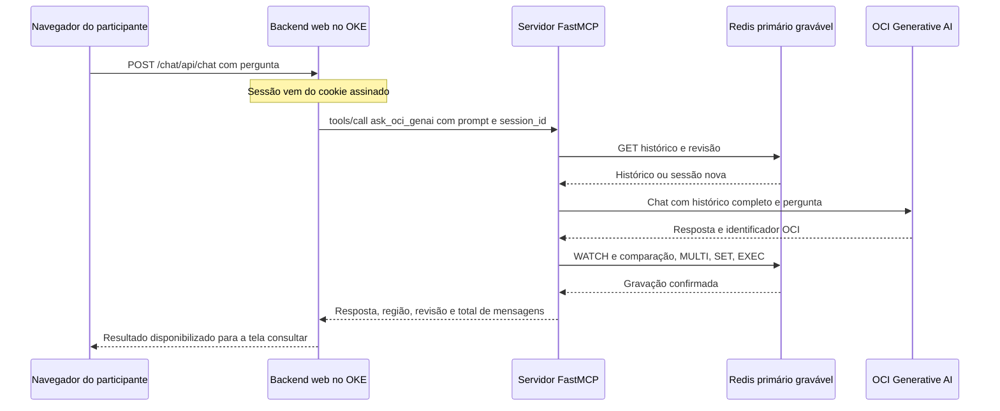

# Resilient HA OCI MCP

Chat público em containers OKE com OCI Generative AI, histórico externo em Redis e demonstração de failover entre São Paulo e Vinhedo. Somente o apresentador autenticado pode interromper e restaurar o MCP primário; cada participante conversa em uma sessão própria.

**[Abrir o chat de demonstração](test)** · **[Manual do usuário](docs/manual-usuario.md)** · **[Manual técnico de implantação](docs/manual-tecnico.md)**


## Escolha seu roteiro

| Você quer | Comece aqui |
| --- | --- |
| Usar a tela e testar a memória | [Manual do usuário com prints e textos para copiar](docs/manual-usuario.md) |
| Apresentar e controlar a interrupção | [Acesso do apresentador e controles](docs/manual-usuario.md#6-entrar-como-apresentador) |
| Entender o código e acompanhar uma chamada | [Código MCP comentado neste README](#entenda-o-código-do-mcp) |
| Reproduzir em outra tenancy OCI | [Manual técnico visual com 24 passos](docs/manual-tecnico.md) |
| Compartilhar o material fora do GitHub | [PDF e Word dos dois manuais](docs/downloads/README.md) |
| Obter todo o código | [Baixar ZIP do repositório](https://github.com/SilvioCristiano/Resilient-HA-OCI-MCP/archive/refs/heads/main.zip) |

## O que a demonstração comprova

O MCP de São Paulo é reduzido de duas para zero réplicas. O DNS passa a indicar Vinhedo e a mesma sessão recupera seu histórico do Redis gravável compartilhado. A recuperação automática dos pods primários ocorre em cinco minutos, com possibilidade de restauração antecipada pelo apresentador.

O frontend também roda nos dois OKE. O Mac do apresentador não hospeda a aplicação pública. Não há cluster dedicado de IA, Gemini, Autonomous Database ou VM administrativa permanente nesta arquitetura.

A demonstração cobre **falha da aplicação MCP primária**. O Redis gravável e a execução GenAI permanecem em São Paulo. O Cache de Vinhedo recebe replicação nativa assíncrona e fica somente leitura; sua promoção não é automática. Portanto, este projeto não comprova zero downtime, RPO zero regional ou recuperação total em menos de dois segundos. Consulte [os limites do desenho](docs/manual-tecnico.md#verificação-técnica-adicional-e-limites-do-laboratório).

## Código incluído

- `app/`: FastMCP, cliente OCI e histórico Redis com controle de versão.
- `web/`: chat, sessões, autenticação do apresentador, limites e controle Kubernetes restrito.
- `Dockerfile`: dois alvos, `mcp` e `web`, construídos a partir de código e imagem pública Python.
- `scripts/`: IAM, Cache e replicação, OCIR, certificados DNS-01, DNS failover e geração/deploy Kubernetes.
- `config/lab.example.json`: campos para os recursos do cliente, sem credenciais do laboratório.
- `tests/`: contexto, isolamento, autorização, repetição segura e manifestos.

## Entenda o código do MCP

**Leia nesta ordem: `server.py` recebe a pergunta → `state.py` recupera a conversa → `oci_llm_client.py` chama a IA → `state.py` salva o resultado.** As versões comentadas abaixo reproduzem o código dos três arquivos; os comentários em português explicam as instruções sem mudar seu funcionamento. Abra cada bloco para acompanhar a leitura junto do arquivo original.

| Arquivo | O que faz | Onde começar a leitura |
| --- | --- | --- |
| [app/server.py](app/server.py) | Publica as duas ferramentas MCP e as sondas de saúde. | `ask_oci_genai`, que coordena um turno da conversa. |
| [app/state.py](app/state.py) | Carrega e grava o histórico Redis com proteção contra concorrência. | `load`, `commit` e `health`. |
| [app/oci_llm_client.py](app/oci_llm_client.py) | Autentica na OCI, monta as mensagens e tenta as APIs regionais. | `__init__` configura os clientes; `chat` envia a inferência. |
| [web/mcp_client.py](web/mcp_client.py) | Faz a ponte entre o backend web e o servidor MCP. | `call_tool` prepara o protocolo e chama a ferramenta. |
| [web/server.py](web/server.py) | Aceita mensagens do participante e devolve resposta e telemetria. | `start` aceita o turno; `work` chama o MCP. |

### Acompanhe uma pergunta do início ao fim



**1. A tela envia a pergunta ao backend web.** O JavaScript usa `/chat/api/chat`. O backend obtém a identidade da sessão pelo cookie assinado e ignora um `session_id` enviado pelo navegador. Assim, um participante não escolhe a conversa de outro pela API pública.

**2. O backend web chama a ferramenta MCP.** Dentro de `work`, em [web/server.py](web/server.py), a chamada é esta; `sid` é a sessão obtida pelo servidor:

```python
# self.client é uma instância de MCPClient, definida em web/mcp_client.py.
# O primeiro retorno contém os dados; o segundo mede a duração da chamada MCP.
result, latency = self.client.call_tool(
    'ask_oci_genai',                         # Nome registrado pelo decorador @mcp.tool().
    {'prompt': prompt, 'session_id': sid}    # Pergunta atual e identificador da conversa.
)
```

`call_tool` envia `initialize`, confirma com `notifications/initialized` e envia `tools/call` por HTTPS para `/mcp`. O backend inclui `Authorization: Bearer ...`, aceita JSON ou SSE e extrai o resultado estruturado. O token permanece no servidor web, sem ser entregue ao participante.

**3. O MCP lê, consulta e grava.** Ele recupera o histórico no Redis, acrescenta a pergunta, chama o GenAI com todas as mensagens e grava pergunta + resposta em uma transação. Só depois da confirmação no Redis devolve sucesso ao backend web.

**4. A tela mostra a prova de contexto.** O backend disponibiliza a resposta e os campos de região, quantidade de mensagens e revisão. Por exemplo, dois turnos concluídos produzem quatro mensagens e revisão 2. Esses números acompanham o resultado; conferir o conteúdo recuperado é o que demonstra que o modelo usou a conversa.

### Leia o servidor ferramenta por ferramenta

**Arquivo original:** [app/server.py](app/server.py). Os objetos `store` e `llm` são clientes de serviços, não a memória da conversa. Cada chamada carrega sua sessão externa de novo.

<details>
<summary><strong>Abrir server.py completo com comentários em português</strong></summary>

```python
# asyncio permite executar as operações bloqueantes do SDK e Redis em outra thread.
import asyncio
# os lê as variáveis de ambiente injetadas no container.
import os
# time mede o tempo de atividade do processo sem depender do relógio de calendário.
import time
# FastMCP registra ferramentas Python e as disponibiliza pelo protocolo MCP.
from fastmcp import FastMCP
# O verificador confere o Bearer token usado pelo backend web para chamar o MCP.
from fastmcp.server.auth.providers.jwt import StaticTokenVerifier
# JSONResponse devolve o JSON das sondas HTTP.
from starlette.responses import JSONResponse
# Este cliente contém as chamadas de inferência para o OCI Generative AI.
from app.oci_llm_client import OCILLMClient
# Este repositório de sessões lê e grava o histórico no Redis externo.
from app.state import SessionStore

# Região do pod MCP que está executando, usada na telemetria da resposta.
REGION = os.environ["OCI_REGION"]
# Marca o início do processo para calcular uptime.
START = time.monotonic()
# Nome do backend de estado informado na ferramenta de diagnóstico.
STATE_BACKEND = "redis"
# Cria o acesso ao Redis TLS indicado por REDIS_URL; não carrega uma conversa ainda.
store = SessionStore(os.environ["REDIS_URL"])
# Cria os clientes de inferência e configura a autenticação OCI.
llm = OCILLMClient()
# Lê a credencial interna MCP; ela não é enviada ao navegador do participante.
token = os.environ["MCP_TOKEN"]
# Impede iniciar o servidor com um token de menos de 32 caracteres.
if len(token) < 32:
    raise ValueError("MCP_TOKEN must have at least 32 characters")
# Cria o servidor MCP com autenticação. O token aceito recebe client_id e escopo mcp.
mcp = FastMCP("OCI Resilient MCP", auth=StaticTokenVerifier(
    tokens={token: {"client_id": "lab-client", "scopes": ["mcp"]}}))


# O decorador publica a função abaixo como ferramenta MCP.
@mcp.tool()
# Recebe a pergunta e o identificador da conversa; devolve um dicionário de resultado.
async def ask_oci_genai(prompt: str, session_id: str) -> dict:
    """Resume a shared conversation. Use an unguessable session_id unique to this client."""
    # Recusa texto vazio, só espaços, ou acima de 32.000 caracteres.
    if not prompt.strip() or len(prompt) > 32000:
        raise ValueError("prompt length must be 1..32000 characters")
    # Lê a versão original em JSON (raw) e o estado interpretado (state).
    # asyncio.to_thread mantém essa chamada Redis fora do event loop.
    raw, state = await asyncio.to_thread(store.load, session_id)
    # Acrescenta a nova mensagem USER ao histórico recuperado.
    history = state["history"] + [{"role": "USER", "text": prompt}]
    # Limita o texto acumulado, incluindo a pergunta atual, a 200.000 caracteres.
    # O limite é em caracteres, não em tokens do modelo.
    if sum(len(x["text"]) for x in history) > 200000:
        raise ValueError("Session context limit exceeded; archive and start a new session")
    # Envia o histórico completo ao cliente OCI. Esta é a chamada de inferência.
    result = await asyncio.to_thread(llm.chat, history)
    # Inclui a resposta ASSISTANT na cópia do histórico que será gravada.
    state["history"] = history + [{"role": "ASSISTANT", "text": result["answer"]}]
    # Incrementa a revisão: cada turno concluído aumenta esse contador em um.
    state["revision"] += 1
    # Guarda metadados da última inferência em tool_context, excluindo o texto da resposta.
    state["tool_context"]["last_inference"] = {k: v for k, v in result.items() if k != "answer"}
    # Grava o estado com comparação da versão original. Se falhar, não retorna sucesso.
    await asyncio.to_thread(store.commit, session_id, raw, state)
    # Retorna resposta e metadados OCI, mais a região deste pod e a revisão salva.
    # history_messages conta USER e ASSISTANT; um turno completo acrescenta duas mensagens.
    return dict(result, app_region=REGION, session_revision=state["revision"],
                history_messages=len(state["history"]))


# Publica a segunda ferramenta MCP, usada para diagnóstico.
@mcp.tool()
async def analyze_resilience_status() -> dict:
    """Return node and shared state health, with inference dependency made explicit."""
    # Informa região e uptime do pod. store.health verifica conexão e papel do Redis.
    # Os campos finais declaram que a execução do modelo continua em São Paulo
    # e que o laboratório não oferece recuperação regional independente da inferência.
    return {"app_region": REGION, "uptime_seconds": time.monotonic() - START,
            "state_healthy": await asyncio.to_thread(store.health), "state_backend": STATE_BACKEND,
            "model_execution_region": "sa-saopaulo-1", "regional_inference_dr": False}


# Cria a rota HTTP de liveness: responde se o processo está atendendo.
@mcp.custom_route("/livez", methods=["GET"])
async def livez(request):
    # Não consulta Redis nem GenAI; uma resposta live não comprova prontidão completa.
    return JSONResponse({"live": True})


# Cria a rota HTTP de readiness usada pelas verificações de saúde.
@mcp.custom_route("/readyz", methods=["GET"])
async def readyz(request):
    try:
        # Consulta a saúde do Redis antes de considerar o MCP pronto.
        await asyncio.to_thread(store.health)
        # Se a verificação passar, responde HTTP 200 com a região do pod.
        return JSONResponse({"ready": True, "app_region": REGION})
    # Se a verificação gerar uma exceção, responde HTTP 503 para retirar o endpoint de serviço.
    except Exception:
        return JSONResponse({"ready": False}, status_code=503)


# Executa o servidor quando o container inicia python -m app.server.
if __name__ == "__main__":
    # Escuta HTTP na porta 8000. O LB publica HTTPS externamente.
    # stateless_http dispensa sessão de transporte MCP presa a um processo;
    # o histórico da conversa continua sendo carregado do Redis a cada ferramenta.
    mcp.run(transport="http", host="0.0.0.0", port=8000, stateless_http=True)
```

</details>

**O que retorna `ask_oci_genai`:**

| Campo | Como interpretar |
| --- | --- |
| `answer` | Texto respondido pelo modelo. |
| `app_region` | Região do pod MCP que concluiu a ferramenta. É o campo que muda no failover da aplicação. |
| `inference_api_region` | API regional OCI usada na tentativa bem-sucedida; pode diferir da região do pod. |
| `model_execution_region` | São Paulo, conforme a configuração de inferência deste laboratório. |
| `request_id` | Identificador `opc-request-id` retornado pela OCI, quando presente. |
| `session_revision` | Número de turnos gravados com sucesso na sessão. |
| `history_messages` | Total de mensagens USER + ASSISTANT após a gravação. |

**As duas verificações de saúde têm funções diferentes.** `/livez` só confirma que o processo atende HTTP. `/readyz` verifica Redis e seu papel gravável; não chama o modelo GenAI. A ferramenta autenticada `analyze_resilience_status` acrescenta uptime e explicita a dependência de inferência em São Paulo. Se o Redis falhar, essa ferramenta gera erro em vez de retornar um objeto de status completo.

### Leia como o histórico fica fora do container

**Arquivo original:** [app/state.py](app/state.py). Todos os pods usam o mesmo algoritmo de chave e acessam o Redis gravável de São Paulo. No caminho de Vinhedo, a configuração do deploy encaminha a conexão pelo LB primário e pela ponte TLS restrita; `state.py` não cria essa rede nem a replicação.

<details>
<summary><strong>Abrir state.py completo com comentários em português</strong></summary>

```python
"""One authoritative OCI Cache. CAS prevents concurrent turns from overwriting history.

No silent empty-history fallback on connectivity errors. This backend preserves context
across MCP node failures, but is NOT a cross-region durable replicated database.
"""
# hashlib calcula o hash usado no nome da chave da sessão.
import hashlib
# json converte o estado entre dicionário Python e texto armazenado no Redis.
import json
# redis é o cliente Python que envia GET, SET, WATCH, MULTI e EXEC ao Cache.
import redis


# Erro específico para impedir que dois turnos concorrentes sobrescrevam o histórico.
class ConflictError(RuntimeError):
    pass


# Centraliza todo o acesso ao estado da conversa; não mantém um dicionário local de sessões.
class SessionStore:
    def __init__(self, url):
        # Aceita somente rediss://, a forma de URL usada para Redis com TLS.
        if not url.startswith("rediss://"):
            raise ValueError("OCI Cache requires a TLS rediss:// URL")
        # Cria o cliente com respostas decodificadas para texto.
        # Os tempos de conexão e operação são 1 e 2 segundos.
        # ssl_cert_reqs exige validação do certificado; credenciais vêm da URL privada.
        self.db = redis.Redis.from_url(url, decode_responses=True,
                                      socket_connect_timeout=1, socket_timeout=2,
                                      ssl_cert_reqs="required")

    # Esta função não usa self: a mesma entrada gera a mesma chave em qualquer pod.
    @staticmethod
    def key(session_id):
        # Valida o comprimento do identificador recebido.
        if not 1 <= len(session_id) <= 256:
            raise ValueError("session_id length must be 1..256")
        # Aplica SHA-256 ao session_id e acrescenta o prefixo mcp:session:.
        # O hash padroniza a chave; não criptografa o conteúdo da conversa.
        return "mcp:session:" + hashlib.sha256(session_id.encode()).hexdigest()

    # Carrega uma sessão pelo seu identificador.
    def load(self, session_id):
        # GET busca o JSON salvo na chave calculada; erro de rede é propagado.
        raw = self.db.get(self.key(session_id))
        # Se a chave existe, interpreta o JSON. Só uma chave ausente inicia histórico vazio.
        # Também devolve raw para comparar a versão antes de gravar.
        return raw, json.loads(raw) if raw else {"history": [], "tool_context": {}, "revision": 0}

    # expected é o JSON original lido antes da inferência; state é a nova versão.
    def commit(self, session_id, expected, state):
        # Calcula novamente a mesma chave da conversa.
        key = self.key(session_id)
        # Abre uma pipeline e libera seus recursos ao terminar o bloco.
        with self.db.pipeline() as tx:
            try:
                # WATCH monitora alterações concorrentes nessa chave.
                tx.watch(key)
                # Compara o valor atual com aquele que a ferramenta carregou antes de chamar a IA.
                if tx.get(key) != expected:
                    # Se já mudou, interrompe o turno para preservar o histórico que outro pedido gravou.
                    raise ConflictError("Concurrent session update; retry this turn")
                # MULTI inicia a transação que agrupa as próximas escritas.
                tx.multi()
                # SET serializa e prepara a nova versão inteira. Não define TTL neste histórico MCP.
                tx.set(key, json.dumps(state))
                # EXEC tenta confirmar a transação; alterações após WATCH fazem a operação falhar.
                tx.execute()
            # Converte a falha de WATCH no mesmo erro de conflito usado na comparação anterior.
            except redis.WatchError as exc:
                raise ConflictError("Concurrent session update; retry this turn") from exc

    # Verificação de saúde chamada tanto pela ferramenta de status quanto por /readyz.
    def health(self):
        # PING precisa responder; falha de conexão também gera erro.
        if not self.db.ping():
            raise RuntimeError("Cache unavailable")
        # A read-only regional replica must not advertise the MCP as ready for writes.
        # INFO replication precisa informar role=master, o papel esperado do primário gravável.
        if self.db.info("replication").get("role") != "master":
            # Uma réplica somente leitura não pode anunciar o MCP como pronto para gravar.
            raise RuntimeError("Cache is not writable; role promotion required")
        # Retorna True quando PING e a verificação de papel passam.
        return True
```

</details>

**Como a comparação evita sobrescritas:** imagine dois pedidos lendo a revisão 1. O primeiro salva a revisão 2. O segundo percebe que o JSON mudou desde sua leitura e recebe `ConflictError`; ele não apaga o turno que já foi salvo. `WATCH` também detecta uma alteração ocorrida entre a comparação e o `EXEC`.

**Se o Cache ficar indisponível, a conversa não é reiniciada silenciosamente.** O erro de leitura é propagado. Uma sessão vazia só é criada quando o `GET` termina e a chave não existe. O histórico MCP é salvo sem TTL; o estado da interface web tem outra estrutura e TTL de 24 horas. O hash do identificador é apenas parte do nome da chave: a conversa continua armazenada como JSON.

**O que não acontece neste arquivo:** não há promoção de réplica ou cópia manual entre regiões. A replicação assíncrona do OCI Cache é configurada pela infraestrutura. O secundário nativo fica somente leitura; o MCP de Vinhedo continua utilizando o primário gravável durante o ensaio.

### Leia a chamada ao OCI Generative AI

**Arquivo original:** [app/oci_llm_client.py](app/oci_llm_client.py). O modelo é usado no modo on demand. O código não provisiona cluster dedicado de IA.

<details>
<summary><strong>Abrir oci_llm_client.py completo com comentários em português</strong></summary>

```python
"""OCI-only inference; the Vinhedo routing profile must target São Paulo only."""
# Lê configuração OCI fornecida por variáveis de ambiente.
import os
# Importa o SDK oficial OCI usado para assinar e enviar a inferência.
import oci

# Define a ordem fixa das tentativas: API São Paulo e, depois, API Vinhedo.
REGIONS = ("sa-saopaulo-1", "sa-vinhedo-1")


# Encapsula autenticação, clientes regionais e a chamada de chat.
class OCILLMClient:
    def __init__(self):
        # Compartment em que a chamada de inferência será autorizada.
        self.compartment = os.environ["OCI_COMPARTMENT_ID"]
        # São Paulo usa o OCID do modelo; Vinhedo usa o OCID do routing profile.
        # O perfil de Vinhedo foi configurado na infraestrutura para executar em São Paulo.
        self.models = {REGIONS[0]: os.environ["OCI_MODEL_ID"],
                       REGIONS[1]: os.environ["OCI_VCP_ROUTING_PROFILE_ID"]}
        # No OKE, o padrão é autenticar pela identidade da instância worker.
        if os.getenv("OCI_AUTH", "instance_principal") == "instance_principal":
            # Cria o assinador Instance Principal; não copia ~/.oci/config para o pod.
            config, signer = {}, oci.auth.signers.InstancePrincipalsSecurityTokenSigner()
        # A alternativa permite desenvolvimento com um profile OCI no computador do operador.
        else:
            # Carrega o profile indicado por OCI_PROFILE ou DEFAULT.
            config = oci.config.from_file(profile_name=os.getenv("OCI_PROFILE", "DEFAULT"))
            # Sem assinador explícito, o SDK usa as credenciais presentes no config carregado.
            signer = None
        # Dicionário que guardará um cliente por região de API.
        self.clients = {}
        # Monta ambos os clientes na inicialização.
        for region in REGIONS:
            # Aponta para o endpoint regional da API OCI Generative AI Inference.
            # O timeout usa 1 segundo para conexão e 30 segundos para leitura.
            # NoneRetryStrategy desativa as repetições automáticas do SDK nesta chamada.
            kwargs = dict(service_endpoint=f"https://inference.generativeai.{region}.oci.oraclecloud.com",
                          timeout=(1, 30), retry_strategy=oci.retry.NoneRetryStrategy())
            # Acrescenta o assinador de instância quando esse modo está ativo.
            if signer:
                kwargs["signer"] = signer
            # Instancia o cliente SDK com região, endpoint, timeouts e autenticação escolhidos.
            self.clients[region] = oci.generative_ai_inference.GenerativeAiInferenceClient(
                dict(config, region=region), **kwargs)

    # Recebe todas as mensagens da conversa, não apenas a última pergunta.
    def chat(self, history):
        # Abrevia o namespace dos modelos de requisição do SDK.
        m = oci.generative_ai_inference.models
        # Converte cada role e text internos em Message e TextContent do SDK.
        # A lista conserva a sequência do histórico e da pergunta atual.
        messages = [m.Message(role=x["role"].upper(), content=[m.TextContent(text=x["text"])])
                    for x in history]
        # Tenta primeiro São Paulo, independentemente da região em que o pod MCP roda.
        for region in REGIONS:
            try:
                # Esta linha envia a chamada ao serviço GenAI usando ChatDetails.
                response = self.clients[region].chat(m.ChatDetails(
                    # Identifica o compartment da chamada.
                    compartment_id=self.compartment,
                    # Usa inferência on demand com o identificador de modelo ou perfil dessa região.
                    serving_mode=m.OnDemandServingMode(model_id=self.models[region]),
                    # Envia as mensagens e limita a geração a 256 tokens.
                    # A temperatura 0 reduz a variação; não é garantia de respostas idênticas.
                    chat_request=m.GenericChatRequest(messages=messages, max_tokens=256,
                                                      temperature=0)))
                # Extrai os trechos textuais da primeira escolha de resposta e os concatena.
                text = "".join(c.text for c in response.data.chat_response.choices[0].message.content
                               if getattr(c, "text", None))
                # Resposta sem texto é tratada como erro de execução; não é considerada sucesso.
                if not text:
                    raise RuntimeError("Empty inference response")
                # Devolve o texto e a região da API que atendeu a tentativa.
                return {"answer": text, "inference_api_region": region,
                        # Informa São Paulo como região de execução, conforme o perfil configurado no laboratório.
                        # Esse campo é uma declaração da configuração, não uma detecção independente do serviço.
                        "model_execution_region": REGIONS[0],
                        # Preserva opc-request-id para correlacionar uma chamada com o atendimento OCI.
                        "request_id": response.headers.get("opc-request-id")}
            # Trata erros HTTP retornados pelo SDK.
            except oci.exceptions.ServiceError as exc:
                # Só tenta a próxima API em 429, 500, 502, 503 ou 504.
                # Outros status, como 401/403, e qualquer falha na última região são propagados.
                if exc.status not in (429, 500, 502, 503, 504) or region == REGIONS[-1]:
                    raise
            # Também permite avançar após os erros de requisição/conexão listados nesta cláusula.
            except (oci.exceptions.RequestException, oci.exceptions.ConnectTimeout):
                # Se já era a última API, propaga o erro em vez de anunciar sucesso.
                if region == REGIONS[-1]:
                    raise
```

</details>

**O failover de API é diferente do failover do MCP.** Um pod em Vinhedo também tenta primeiro a API `sa-saopaulo-1`. Somente uma falha elegível faz o loop tentar `sa-vinhedo-1`, usando o routing profile. Esse perfil continua encaminhando a execução do modelo para São Paulo. Portanto, ver `app_region=sa-vinhedo-1` não significa que o modelo executou em Vinhedo nem que o Cache secundário foi promovido.

**As repetições são limitadas e explícitas.** O cliente OCI avança de região apenas nas exceções listadas no código; erros de autenticação e resposta vazia não passam por esse fallback. Na aplicação web, `work` pode repetir a chamada após HTTP 503 identificado pelo cliente como indisponibilidade antes da execução, aguardando dois segundos e respeitando sua janela de reconexão. Erros de execução ou de transporte com resultado incerto encerram o turno sem repetição automática. O MCP, por si só, não recebe uma chave de idempotência por turno: a comparação de estado evita sobrescrita concorrente, mas não garante execução única da inferência.

### Saiba de onde vêm os valores do código

Os parâmetros são injetados nos pods pelos manifestos gerados a partir de `config/lab.json` e dos segredos privados de `.runtime/`. O código lê os valores pelo ambiente; não é necessário substituir OCIDs dentro dos arquivos Python.

| Variável | Quem lê | Para que serve |
| --- | --- | --- |
| `OCI_REGION` | MCP | Identificar a região do pod na resposta e no status. |
| `REDIS_URL` | MCP | URL `rediss://` com endereço e autenticação do Redis gravável. É um segredo. |
| `MCP_TOKEN` | MCP e backend web | Autenticar as chamadas de ferramenta; mínimo de 32 caracteres no servidor MCP. |
| `OCI_COMPARTMENT_ID` | Cliente OCI | Autorizar a chamada no compartment do projeto. |
| `OCI_MODEL_ID` | Cliente OCI | Identificar o modelo on demand de São Paulo. |
| `OCI_VCP_ROUTING_PROFILE_ID` | Cliente OCI | Identificar o routing profile de Vinhedo. |
| `OCI_AUTH` | Cliente OCI | Usar `instance_principal` por padrão; outro valor seleciona o profile local do SDK. |
| `OCI_PROFILE` | Cliente OCI em modo local | Selecionar o profile em `~/.oci/config`; padrão `DEFAULT`. |
| `MCP_HOST` | Backend web | Hostname global usado nas chamadas HTTPS ao MCP. |

**Onde começa a execução do container:** o alvo `mcp` do [Dockerfile](Dockerfile) executa `python -m app.server` na porta 8000; o alvo `web` executa `web/server.py` na porta 8088. O [gerador Kubernetes](scripts/rendering.py) monta os Deployments, Services, Secrets, probes e proxy. O controle autenticado de interrupção está no backend web e em [web/control.py](web/control.py); ele não é uma ferramenta pública do MCP.

**Para conferir o comportamento sem chamar a OCI:** [tests/test_resilience.py](tests/test_resilience.py) verifica retomada do estado externo, conflito de gravação, Cache indisponível, réplica somente leitura e fallback de API com o histórico completo. [tests/test_public_web.py](tests/test_public_web.py) cobre isolamento das sessões e autorização do apresentador. Esses testes usam simulações; o ensaio real está descrito no [registro de validação](docs/validacao-referencia.json).

## Preparar uma implantação própria

Siga o [manual técnico](docs/manual-tecnico.md) desde a preparação de conta e rede. Os comandos abaixo apenas obtêm e preparam o pacote; não criam recursos OCI.

```bash
git clone https://github.com/SilvioCristiano/Resilient-HA-OCI-MCP.git
cd Resilient-HA-OCI-MCP
python3 -m venv .venv
source .venv/bin/activate
python -m pip install -r requirements-tools.txt
cp config/lab.example.json config/lab.json
```

Preencha os identificadores da sua tenancy, crie os OKE e a rede, e execute as fases na ordem descrita no manual. Os comandos cloud mostram um plano por padrão e só alteram recursos quando recebem `--apply`. A emissão inicial de certificado exige autorização dos termos da certificadora.

OKE, workers, Cache, Load Balancers, tráfego e demais serviços podem gerar custos. A configuração de Cache do laboratório usa dois nós por região; o console recomenda pelo menos três nós para alta disponibilidade em produção.

## Validação e procedência

O ambiente de referência foi implantado e ensaiado na OCI. Dois participantes mantiveram suas próprias conversas em Vinhedo: as chamadas bem-sucedidas levaram 0,709 s e 0,872 s; o intervalo desde a interrupção foi 62,532 s e 66,638 s. São métricas daquela execução, sem compromisso de SLA. Veja o [registro de validação sem identificadores privados](docs/validacao-referencia.json).

O [roteiro técnico visual](docs/manual-tecnico.md) traz ações numeradas, prints com marcações e etapas separadas para São Paulo e Vinhedo. A [referência técnica detalhada](docs/referencia-tecnica.md) reúne os detalhes de engenharia.

A versão parametrizada tem testes locais e workflow de validação de código e construção das duas imagens. Uma implantação nova em outra tenancy precisa de validação própria de permissões, rede, disponibilidade e custos. As capturas dos manuais são reais; identificadores privados foram ocultados. O desenho representa a arquitetura publicada.

```bash
python -m pip install -r requirements-tools.txt
python -m unittest discover -s tests -v
```

Nunca publique `.runtime/`, `config/lab.json`, kubeconfigs, chaves, tokens ou YAMLs gerados com Secrets. O pacote não contém as imagens privadas, credenciais ou OCIDs do autor. Consulte [as notas de terceiros](THIRD_PARTY_NOTICES.md) sobre a imagem e as marcas presentes na interface.

Autor do laboratório: **Silvio Cristiano**. Documentação em português. Edição de referência: **9 de novembro de 2026**.
