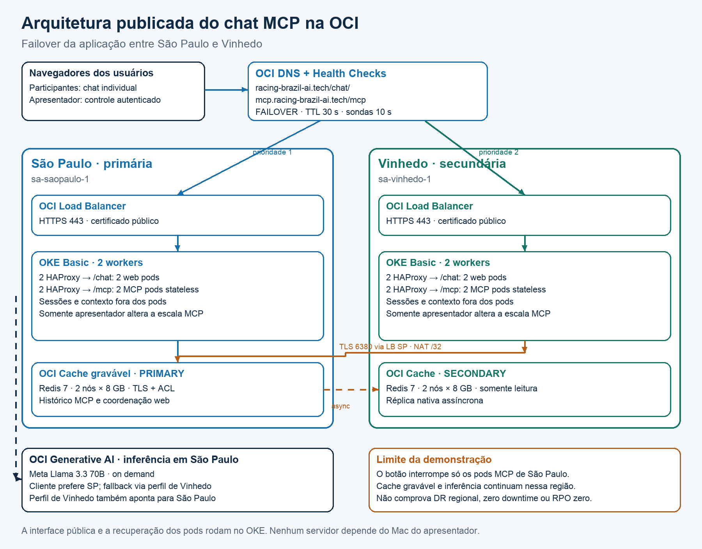

# Resilient HA OCI MCP

Chat público em containers OKE com OCI Generative AI, histórico externo em Redis e demonstração de failover entre São Paulo e Vinhedo. Somente o apresentador autenticado pode interromper e restaurar o MCP primário; cada participante conversa em uma sessão própria.

**[Abrir o chat de demonstração](https://racing-brazil-ai.tech/chat/)** · **[Manual do usuário](docs/manual-usuario.md)** · **[Manual técnico de implantação](docs/manual-tecnico.md)**



## Escolha seu roteiro

| Você quer | Comece aqui |
| --- | --- |
| Usar a tela e testar a memória | [Manual do usuário com prints e textos para copiar](docs/manual-usuario.md) |
| Apresentar e controlar a interrupção | [Acesso do apresentador e controles](docs/manual-usuario.md#6-entrar-como-apresentador) |
| Reproduzir em outra tenancy OCI | [Manual técnico com 20 etapas](docs/manual-tecnico.md) |
| Compartilhar o material fora do GitHub | [PDF e Word dos dois manuais](docs/downloads/README.md) |
| Obter todo o código | [Baixar ZIP do repositório](https://github.com/SilvioCristiano/Resilient-HA-OCI-MCP/archive/refs/heads/main.zip) |

## O que a demonstração comprova

O MCP de São Paulo é reduzido de duas para zero réplicas. O DNS passa a indicar Vinhedo e a mesma sessão recupera seu histórico do Redis gravável compartilhado. A recuperação automática dos pods primários ocorre em cinco minutos, com possibilidade de restauração antecipada pelo apresentador.

O frontend também roda nos dois OKE. O Mac do apresentador não hospeda a aplicação pública. Não há cluster dedicado de IA, Gemini, Autonomous Database ou VM administrativa permanente nesta arquitetura.

A demonstração cobre **falha da aplicação MCP primária**. O Redis gravável e a execução GenAI permanecem em São Paulo. O Cache de Vinhedo recebe replicação nativa assíncrona e fica somente leitura; sua promoção não é automática. Portanto, este projeto não comprova zero downtime, RPO zero regional ou recuperação total em menos de dois segundos. Consulte [os limites do desenho](docs/manual-tecnico.md#18-distinguir-failover-da-aplicação-de-desastre-regional).

## Código incluído

- `app/`: FastMCP, cliente OCI e histórico Redis com controle de versão.
- `web/`: chat, sessões, autenticação do apresentador, limites e controle Kubernetes restrito.
- `Dockerfile`: dois alvos, `mcp` e `web`, construídos a partir de código e imagem pública Python.
- `scripts/`: IAM, Cache e replicação, OCIR, certificados DNS-01, DNS failover e geração/deploy Kubernetes.
- `config/lab.example.json`: campos para os recursos do cliente, sem credenciais do laboratório.
- `tests/`: contexto, isolamento, autorização, repetição segura e manifestos.

## Preparar uma implantação própria

Siga o [manual técnico](docs/manual-tecnico.md) desde a preparação de conta e rede. Os comandos abaixo apenas obtêm e preparam o pacote; não criam recursos OCI.

```bash
git clone https://github.com/SilvioCristiano/Resilient-HA-OCI-MCP.git
cd Resilient-HA-OCI-MCP
python3 -m venv .venv
source .venv/bin/activate
python -m pip install -r requirements-tools.txt
cp config/lab.example.json config/lab.json
```

Preencha os identificadores da sua tenancy, crie os OKE e a rede, e execute as fases na ordem descrita no manual. Os comandos cloud mostram um plano por padrão e só alteram recursos quando recebem `--apply`. A emissão inicial de certificado exige autorização dos termos da certificadora.

OKE, workers, Cache, Load Balancers, tráfego e demais serviços podem gerar custos. A configuração de Cache do laboratório usa dois nós por região; o console recomenda pelo menos três nós para alta disponibilidade em produção.

## Validação e procedência

O ambiente de referência foi implantado e ensaiado na OCI. Dois participantes mantiveram suas próprias conversas em Vinhedo: as chamadas bem-sucedidas levaram 0,709 s e 0,872 s; o intervalo desde a interrupção foi 62,532 s e 66,638 s. São métricas daquela execução, sem compromisso de SLA. Veja o [registro de validação sem identificadores privados](docs/validacao-referencia.json).

A versão parametrizada tem testes locais e workflow de validação de código e construção das duas imagens. Uma implantação nova em outra tenancy precisa de validação própria de permissões, rede, disponibilidade e custos. As capturas dos manuais são reais; identificadores privados foram ocultados. O desenho representa a arquitetura publicada.

```bash
python -m pip install -r requirements-tools.txt
python -m unittest discover -s tests -v
```

Nunca publique `.runtime/`, `config/lab.json`, kubeconfigs, chaves, tokens ou YAMLs gerados com Secrets. O pacote não contém as imagens privadas, credenciais ou OCIDs do autor. Consulte [as notas de terceiros](THIRD_PARTY_NOTICES.md) sobre a imagem e as marcas presentes na interface.

Autor do laboratório: **Silvio Cristiano**. Documentação em português. Edição de referência: **9 de novembro de 2026**.
