# Manual técnico visual do laboratório MCP na OCI

**Siga uma etapa por vez para montar o laboratório em outra conta OCI.** Em cada passo você encontrará onde trabalhar, a ação exata e o resultado que deve conferir antes de continuar.

**Autor:** Silvio Cristiano. **Revisão visual:** 10 de novembro de 2026. O roteiro usa São Paulo como região primária e Vinhedo como secundária. Os prints são reais, com identificadores privados ocultados; os mapas e cartões indicados como ilustrativos ajudam a localizar as ações.

**Você vai alternar entre dois lugares:** o **Console OCI**, aberto no navegador, e o **Terminal**, no computador técnico. Copie os comandos somente nos passos marcados como Terminal. Use sempre os identificadores e o domínio da conta do cliente.

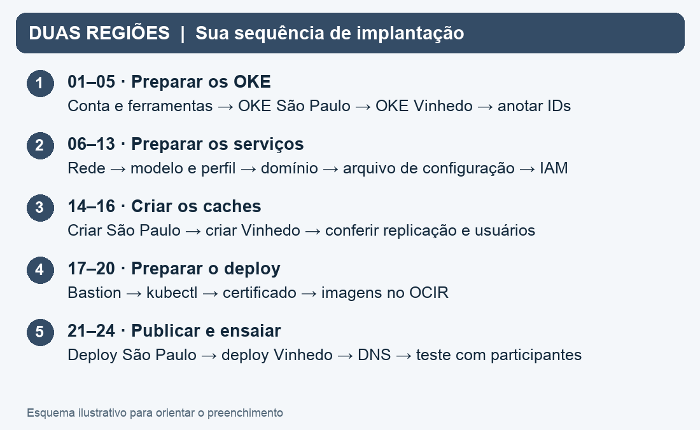

**Como ler o roteiro:** azul identifica São Paulo; verde identifica Vinhedo; cinza identifica etapas compartilhadas ou o Terminal. Os números sobre os prints apontam os campos citados no texto. O bloco **Confira** encerra cada passo.

## Antes de começar

**Conheça os nomes que aparecem nas telas.** Você não precisa dominar OCI para seguir o roteiro, mas precisa reconhecer estes termos:

| Palavra usada | Significado neste laboratório |
| --- | --- |
| Tenancy | A conta OCI da organização. |
| Compartment | A pasta administrativa que agrupa recursos e permissões. |
| Região | O local OCI em que você está criando o recurso. |
| VCN e sub-rede | A rede virtual e uma divisão dessa rede. |
| NSG | Grupo de regras que permite ou bloqueia conexões. |
| OKE e worker | Kubernetes gerenciado e as máquinas que executam os containers. |
| Cache primário e secundário | Redis gravável em São Paulo e réplica somente leitura em Vinhedo. |

**O que será provisionado em cada região**

| Recurso | São Paulo | Vinhedo |
| --- | --- | --- |
| OKE | Um cluster Basic com dois workers | Um cluster Basic com dois workers |
| OCI Cache Redis | Dois nós de 8 GB; primário gravável | Dois nós de 8 GB; réplica somente leitura |
| Load Balancer | Um LB para a aplicação e a ponte TLS Redis | Um LB para a aplicação |
| GenAI | Inferência sob demanda | Perfil que encaminha a inferência para São Paulo |

**Antes de criar:** este roteiro usa recursos pagos. Se o ambiente já existe, use os passos de conferência; não crie outro conjunto para repetir os prints. O desenho validado protege a falha dos pods MCP primários; Cache gravável e inferência continuam em São Paulo.

Para investigar os detalhes de engenharia sem interromper a execução, consulte a [referência técnica](referencia-tecnica.md). Para operar a tela, use o [manual do usuário](manual-usuario.md).

## Passo 01 Escolher a conta o compartment e as regiões

**ONDE — Console OCI | Ambas as regiões**

**Faça agora**

1. **Selecione a conta OCI do cliente.** Peça ao administrador acesso ao compartment do projeto e autorização para os recursos pagos.
2. **Escolha ou crie um compartment exclusivo**, por exemplo `mcp-lab`. Anote seu OCID, o identificador mostrado em Details.
3. **Abra o seletor de região no topo da tela.** Confira São Paulo e Vinhedo. Se alguma não estiver disponível, o administrador deve assinar a região.
4. **Use o mesmo compartment nas duas regiões.** O compartment existe na tenancy inteira; a seleção de região é independente.

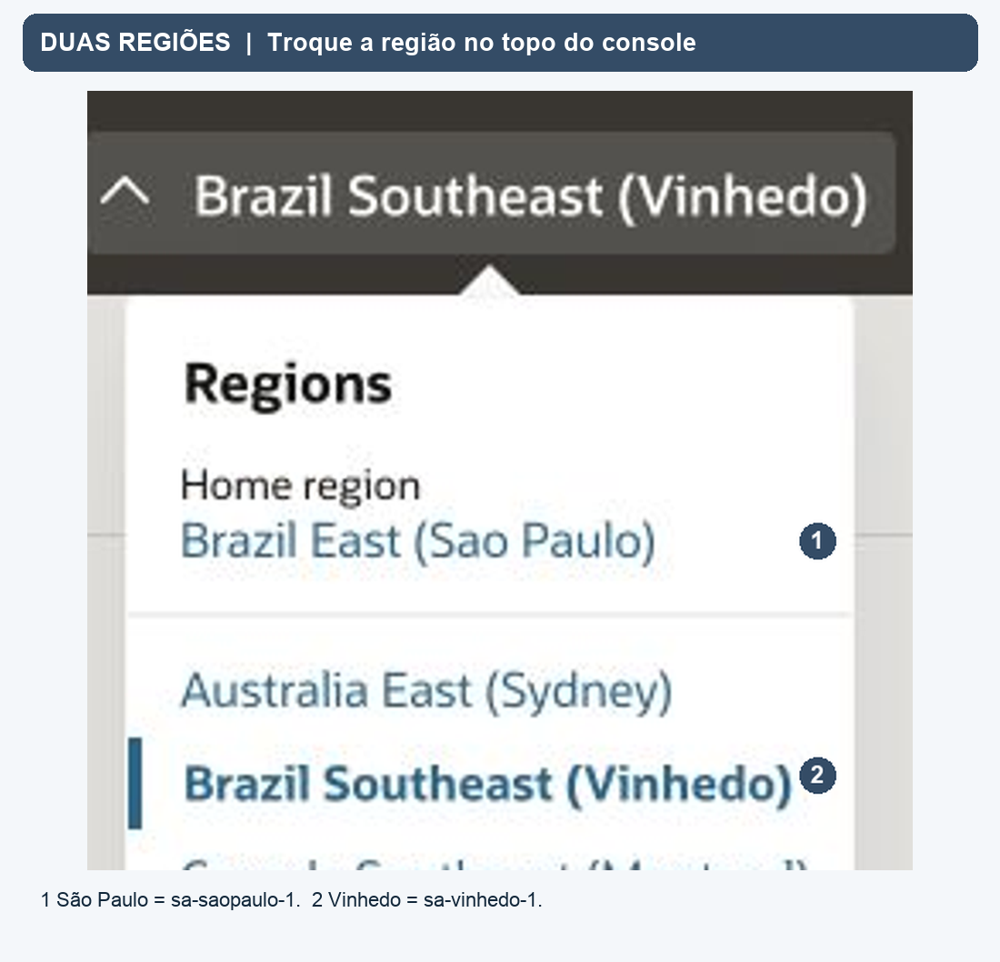

**Confira —** você consegue selecionar **Brazil East Sao Paulo** e **Brazil Southeast Vinhedo** e localizar o compartment do cliente. O print mostra os nomes reais das regiões, não um comando de criação.

## Passo 02 Preparar o computador e baixar o código

**ONDE — Terminal | Computador técnico**

**Faça agora**

1. **Instale** Python 3.12, Git, OCI CLI, kubectl, Docker e dig pelas [fontes oficiais](referencia-tecnica.md#20-localizar-o-código-e-as-referências).
2. **Inicie o Docker** e aguarde o daemon ficar disponível.
3. **Baixe o projeto e prepare o Python:**

```bash
git clone https://github.com/SilvioCristiano/Resilient-HA-OCI-MCP.git
cd Resilient-HA-OCI-MCP
python3 -m venv .venv
source .venv/bin/activate
python -m pip install -r requirements-tools.txt
oci setup config
```

4. **Confira as ferramentas:**

```bash
oci iam region-subscription list
kubectl version --client=true
docker version
```

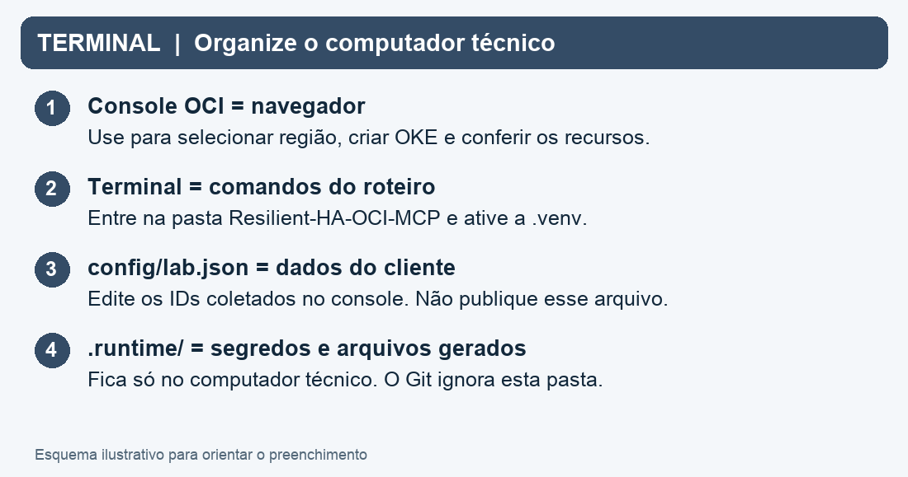

**Confira —** OCI CLI lista as regiões e Docker mostra cliente e servidor. Mantenha este terminal dentro da pasta do projeto. Guarde `~/.oci/config` e sua chave no computador; não os envie ao GitHub nem ao container.

## Passo 03 Provisionar o OKE de São Paulo

**ONDE — Console OCI | SÃO PAULO | sa-saopaulo-1**

**Caminho — Developer Services → Kubernetes Clusters OKE → Create cluster → Quick Create.**

**Faça agora**

1. **Selecione São Paulo no topo** e o compartment do cliente.
2. **Preencha o nome** `mcp-resilience-gru`.
3. **Configure os campos abaixo**, revise o custo e confirme a criação. Se o fluxo começar em Enhanced, escolha a alternativa **Basic** na revisão, conforme o console disponível.

| Campo | Valor para acompanhar o laboratório |
| --- | --- |
| Tipo de cluster | Basic |
| Nodes | Managed nodes, quantidade 2 |
| Arquitetura | x86 AMD64 |
| Capacidade de referência por worker | E3 Flex, 1 OCPU e 16 GB RAM; substitua por uma shape x86 disponível se necessário |
| Acesso | Workers privados e API Kubernetes privada |
| Rede de pods | VCN-native |
| Kubernetes | Versão suportada e compatível com seu kubectl |

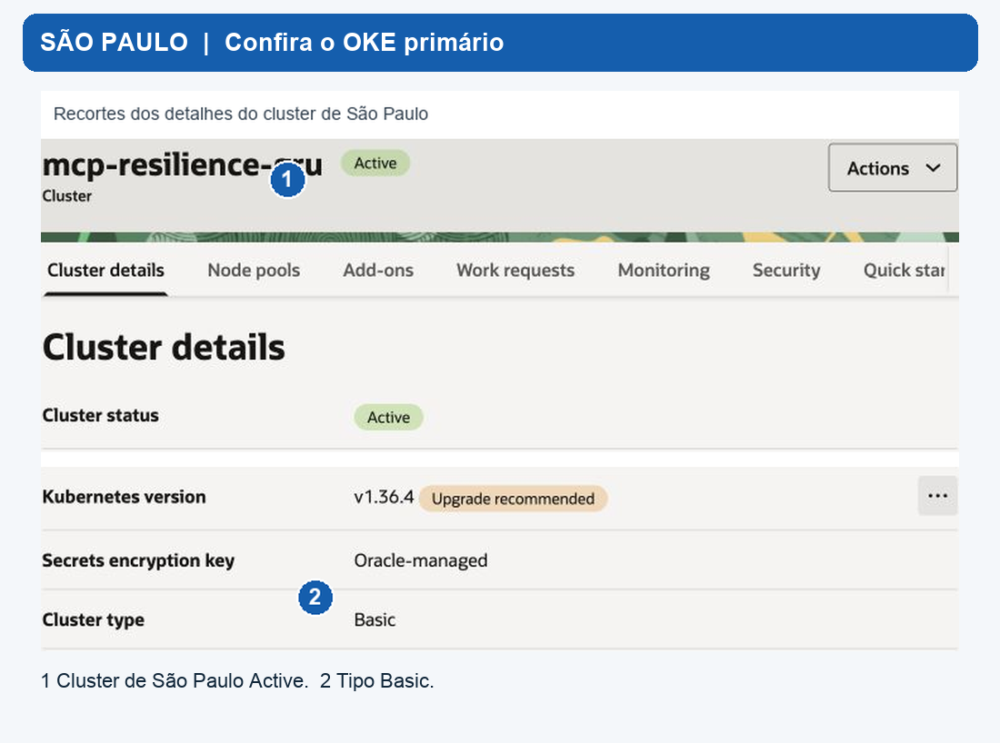

**Confira —** o cluster aparece **Active** e **Basic**. Aguarde também os dois workers ficarem Ready. O print é do cluster já provisionado; os campos da criação devem seguir a tabela.

## Passo 04 Provisionar o OKE de Vinhedo

**ONDE — Console OCI | VINHEDO | sa-vinhedo-1**

**Caminho — Developer Services → Kubernetes Clusters OKE → Create cluster → Quick Create.**

**Faça agora**

1. **Troque a região para Vinhedo.** Confira o nome da região antes de criar.
2. **Selecione o compartment do cliente** e o nome `mcp-resilience-vcp`.
3. **Escolha Basic, dois managed workers x86**, API e workers privados e rede VCN-native, acompanhando a capacidade do passo 03.
4. **Conclua a criação e aguarde Active.**

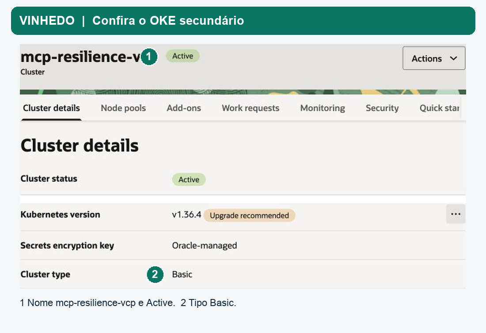

**Confira —** o nome termina em **vcp**, o tipo é **Basic** e a região selecionada é Vinhedo. Não basta criar outro cluster em São Paulo.

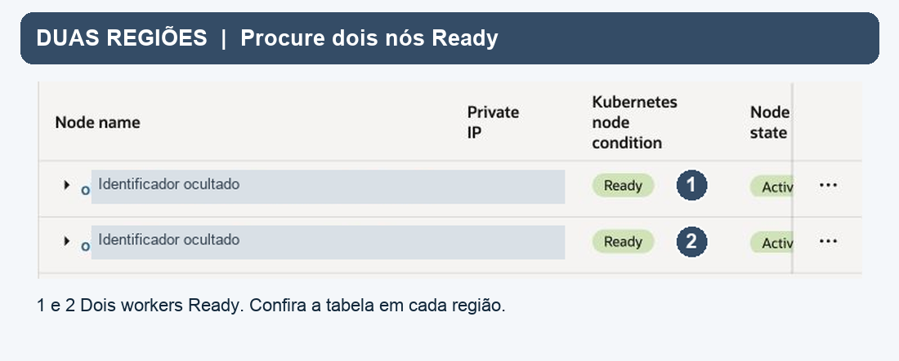

**Confira também —** em Node pools → seu pool → Nodes, há **dois workers Ready em cada região**. A tabela ilustrada é a captura de São Paulo. Se o pool não aparecer, revise o filtro de compartment.

## Passo 05 Anotar os identificadores dos dois OKE

**ONDE — Console OCI | Faça uma coleta em cada região**

**Faça agora**

1. **Abra Cluster details** e copie os OCIDs do cluster e da VCN.
2. **Abra a VCN e suas sub-redes.** Anote a sub-rede pública dos LBs e a privada dos workers.
3. **Abra o NAT Gateway** da VCN e anote seu IP público de saída.
4. **Abra os dois workers do node pool** e copie seus OCIDs de instância Compute.

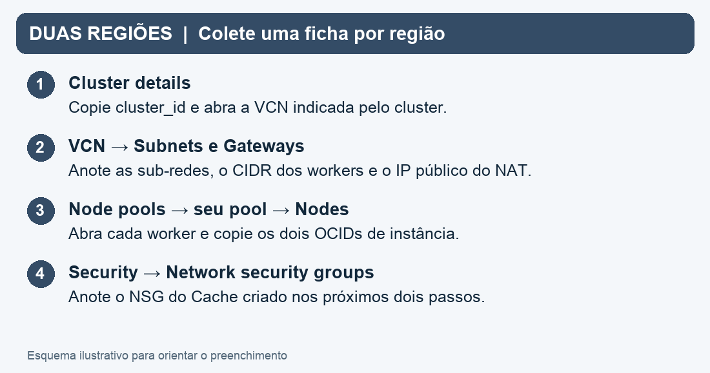

| Anote para cada região | Campo usado no arquivo do projeto |
| --- | --- |
| Cluster OKE e VCN | cluster_id e vcn_id |
| Sub-rede pública de LB | lb_subnet_id |
| Sub-rede privada escolhida para Cache | cache_subnet_id |
| CIDR real dos workers e IP do NAT | worker_cidr e nat_ip |
| Dois OCIDs de instância dos workers | workers |

**Confira —** você tem uma lista de São Paulo e outra de Vinhedo. Use os valores reais da conta do cliente, mesmo quando forem diferentes dos exemplos. O laboratório aceita CIDRs sobrepostos entre regiões pelo caminho TLS explicado no passo 22; esse desenho não usa peering entre VCNs.

## Passo 06 Preparar o acesso ao Cache de São Paulo

**ONDE — Console OCI | SÃO PAULO | sa-saopaulo-1**

**Caminho — Networking → Virtual cloud networks → VCN de São Paulo → Security → Network security groups.**

**Faça agora**

1. **Crie um NSG** com nome como `mcp-cache-gru` no compartment do cliente.
2. **Abra Security rules → Add rules.** Adicione uma regra de entrada stateful, origem **CIDR real dos workers de São Paulo**, protocolo TCP, porta de destino **6379**.
3. **Mantenha a saída necessária e as regras internas OKE.** Não substitua todas as regras da rede pelo exemplo.
4. **Copie o OCID desse NSG** para a lista de São Paulo. Ele será `cache_nsg_id`.

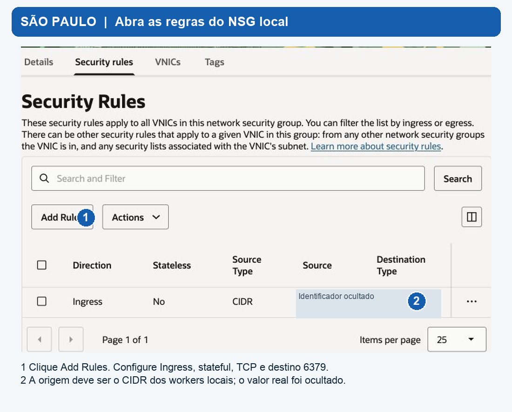

**Confira —** a origem é a rede dos workers locais e a porta é 6379. O Cache ficará em uma sub-rede privada; não abra essa porta para `0.0.0.0/0`.

## Passo 07 Preparar o acesso ao Cache de Vinhedo

**ONDE — Console OCI | VINHEDO | sa-vinhedo-1**

**Caminho — Networking → Virtual cloud networks → VCN de Vinhedo → Security → Network security groups.**

**Faça agora**

1. **Troque a região para Vinhedo.** Abra a VCN do OKE secundário.
2. **Crie o NSG** `mcp-cache-vcp` no compartment do cliente.
3. **Adicione entrada stateful TCP 6379**, com origem no **CIDR real dos workers de Vinhedo**.
4. **Copie o OCID do NSG de Vinhedo** para `cache_nsg_id` dessa região.

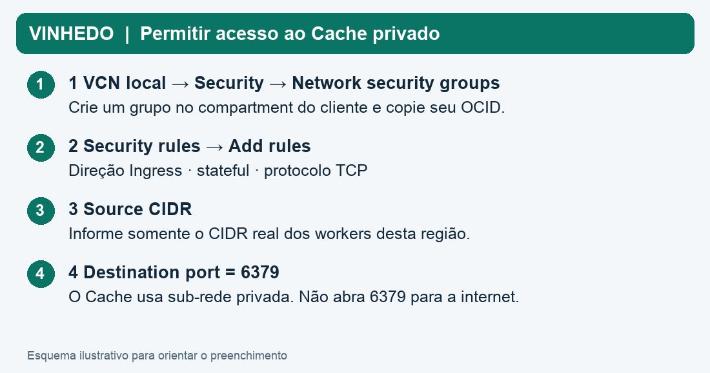

**Confira —** o NSG e a sub-rede pertencem à VCN de Vinhedo. Não reutilize os OCIDs de São Paulo. O cartão é um mapa de preenchimento, não uma captura de uma regra já aplicada na sua conta.

## Passo 08 Preparar as portas dos Load Balancers

**ONDE — Console OCI | Ambas as regiões**

**Faça agora —** nas security lists ou NSGs das sub-redes, **configure os caminhos da tabela**. O manifesto usa gerenciamento automático de security lists desativado; estas regras precisam ser preparadas pelo operador.

| Origem | Destino | Porta TCP |
| --- | --- | --- |
| Internet | LB regional | 443 |
| Sub-rede do LB regional | Workers locais | 32443 e 10256 |
| Sub-rede do LB de São Paulo | Workers de São Paulo | 32380 |
| NAT de Vinhedo em /32 | LB de São Paulo | 6380 |
| Workers locais | Cache local | 6379 |

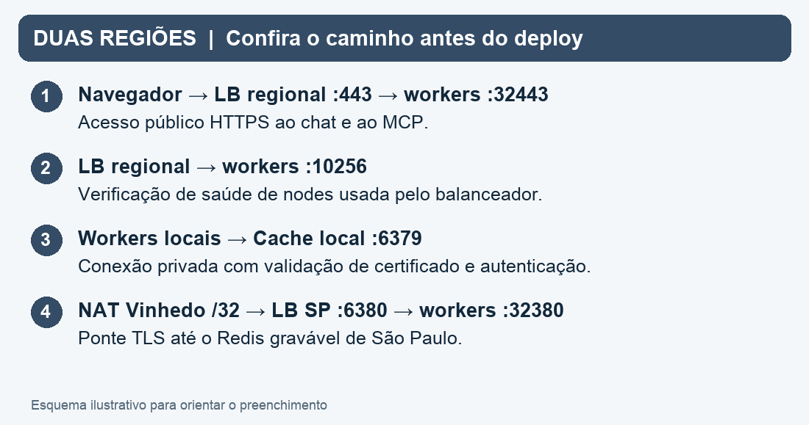

**Confira —** os workers privados têm saída HTTPS para APIs OCI e registry, via NAT ou os caminhos aprovados. Com VCN-native, revise também as regras da sub-rede de pods e as [regras completas OKE](https://docs.oracle.com/en-us/iaas/Content/ContEng/Concepts/contengnetworkconfig.htm).

**Aplique a restrição 6380 ao LB de São Paulo quando ele existir no passo 21.** A origem deve ser somente o NAT de Vinhedo em /32. Essa porta atende a aplicação secundária; a replicação nativa do Cache usa conectividade privada gerenciada pela OCI.

## Passo 09 Selecionar o modelo GenAI em São Paulo

**ONDE — Console OCI | SÃO PAULO | sa-saopaulo-1**

**Caminho — Analytics and AI → Generative AI.**

**Faça agora**

1. **Confira a disponibilidade on demand** de `meta.llama-3.3-70b-instruct` na região.
2. **Copie o OCID do modelo** para preencher `model_id` no passo 12.
3. **Mantenha o modo on demand.** Este projeto não pede criação de Dedicated AI Cluster ou endpoint dedicado.

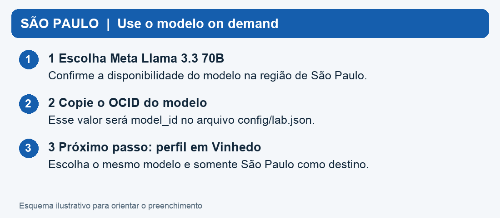

**Confira —** você anotou um **OCID de modelo**, não de cluster dedicado. O código fornecido usa `GenericChatRequest` para a família Meta. Se o modelo não estiver mais disponível, revise o cliente e as regiões antes de substituir apenas o identificador.

## Passo 10 Criar o routing profile de Vinhedo

**ONDE — Console OCI | VINHEDO | sa-vinhedo-1**

**Caminho — Analytics and AI → Generative AI → Routing profiles → Create routing profile.**

**Faça agora**

1. **Selecione o mesmo modelo Meta** do passo 09.
2. **Escolha somente São Paulo** como região de destino.
3. **Crie o perfil**, aguarde Active e copie seu OCID para `vinhedo_routing_profile_id`.

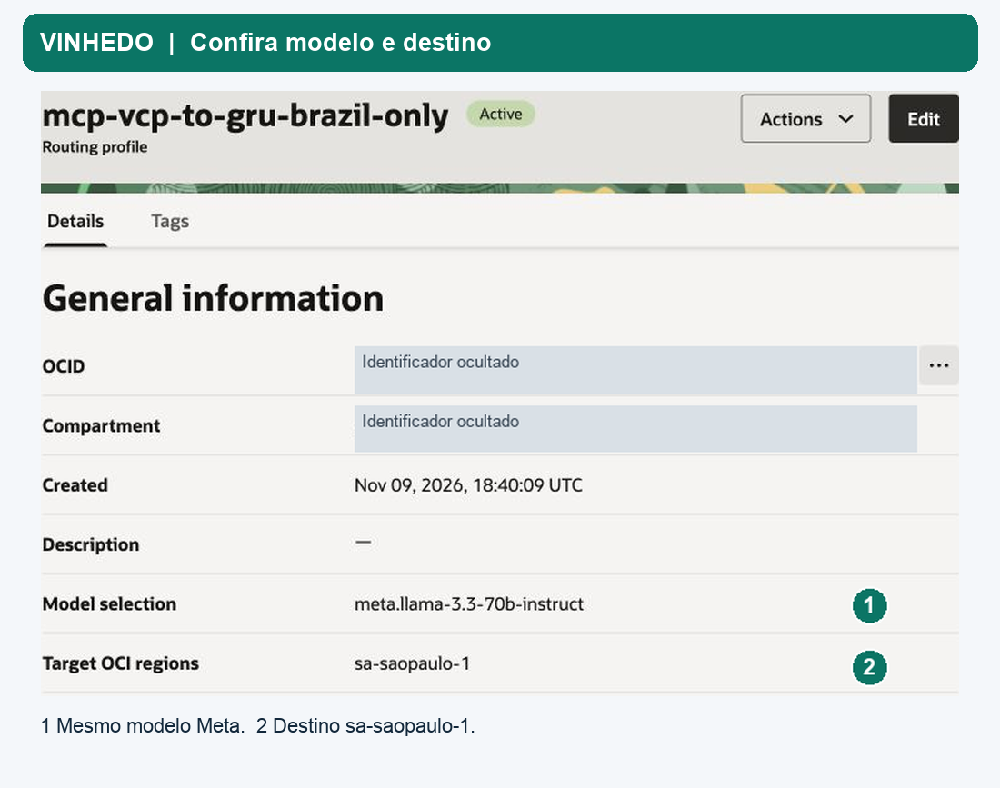

**Confira —** o campo **Model selection** corresponde ao modelo e **Target OCI regions** mostra **sa-saopaulo-1**. O perfil existe em Vinhedo, mas a inferência desse desenho continua em São Paulo.

## Passo 11 Preparar o domínio e a zona DNS pública

**ONDE — Console OCI e painel do registrador do domínio**

**Caminho — Networking → DNS Management → Zones → Public zones → Create zone.**

**Faça agora**

1. **Crie a zona pública** para o domínio do cliente, por exemplo `seu-dominio.com`.
2. **Copie o OCID da zona** e os nameservers apresentados pela OCI.
3. **No registrador, como HostGator, configure esses nameservers.** Mantenha registros de outros serviços se o domínio já estiver em uso.
4. **Defina o hostname MCP** como `mcp.seu-dominio.com`.

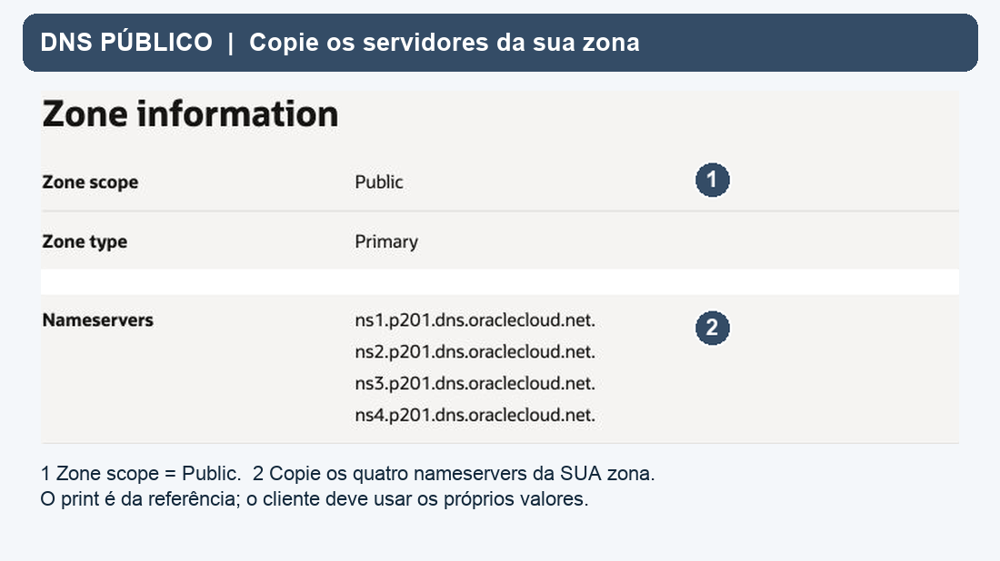

**Confira —** a delegação aponta para os **nameservers OCI**, não para o IP do LB. Uma zona privada não publica o chat para os participantes da internet. Aguarde a delegação antes de emitir o certificado no passo 19.

## Passo 12 Preencher a configuração do cliente

**ONDE — Terminal e editor de texto | Computador técnico**

**Faça agora**

1. **Copie o arquivo de exemplo** e gere os segredos locais:

```bash
cp config/lab.example.json config/lab.json
python scripts/lab.py init
```

2. **Abra `config/lab.json` no editor.** Substitua os campos `REPLACE_ME` e os domínios `.invalid` pelos valores coletados.
3. **Preencha as duas entradas regionais.** Mantenha `context` como `gru` e `vcp`; informe dois workers por região.
4. **Descubra o namespace OCIR da conta:** execute o comando abaixo e copie o valor retornado para `registry_namespace`. Esse valor é o namespace do Object Storage usado também pelo registry; não é o nome do compartment.

```bash
oci os ns get --query data --raw-output
```

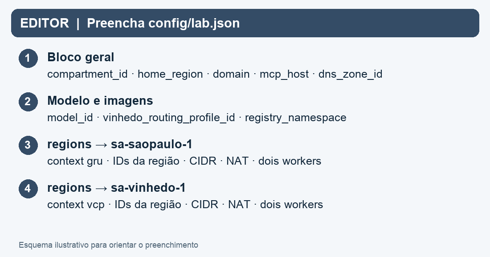

**Confira —** domínio, zona, modelo, perfil, namespace OCIR e os dados regionais pertencem ao cliente. A home region é a região principal de IAM da tenancy, não uma escolha de failover.

**Guarde —** `.runtime/secrets.json` e `.runtime/presenter-access.txt`, que contém a senha do apresentador. Esses arquivos e os YAMLs gerados ficam fora do Git porque contêm credenciais. Não use a senha do laboratório publicado.

## Passo 13 Autorizar os quatro workers

**ONDE — Terminal | Com uma identidade autorizada a administrar IAM**

**Faça agora**

1. **Confira o plano**, sem aplicar:

```bash
python scripts/cloud.py iam
```

2. **Confira os quatro OCIDs de worker** em `config/lab.json`. Só depois aplique:

```bash
python scripts/cloud.py iam --apply
```

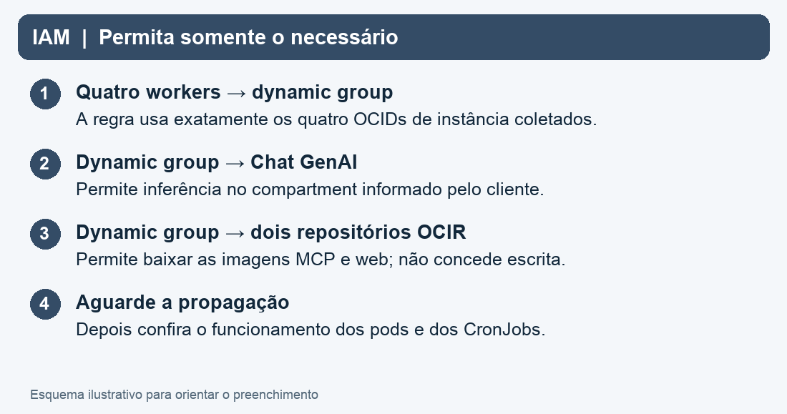

**Confira —** o helper informa IAM restrito aos quatro workers. Ele cria um dynamic group por identidade de instância e autoriza Chat GenAI e leitura dos dois repositórios OCIR. Aguarde a propagação das políticas antes de testar os pods.

**Se der erro —** o administrador precisa conceder o acesso de operação. Não troque o escopo por `manage all-resources in tenancy` para tentar resolver. O helper recusa reaproveitar um grupo com regra diferente.

## Passo 14 Provisionar o Cache de São Paulo

**ONDE — Terminal para criar | Console OCI em SÃO PAULO para conferir**

**Faça agora**

1. **Confira o plano de São Paulo:**

```bash
python scripts/cloud.py cache --region sa-saopaulo-1
```

2. **Crie somente o Cache primário:**

```bash
python scripts/cloud.py cache --region sa-saopaulo-1 --apply
```

3. **Aguarde o comando terminar.** Abra **Databases → OCI Cache → Clusters → mcp-context-gru** em São Paulo.

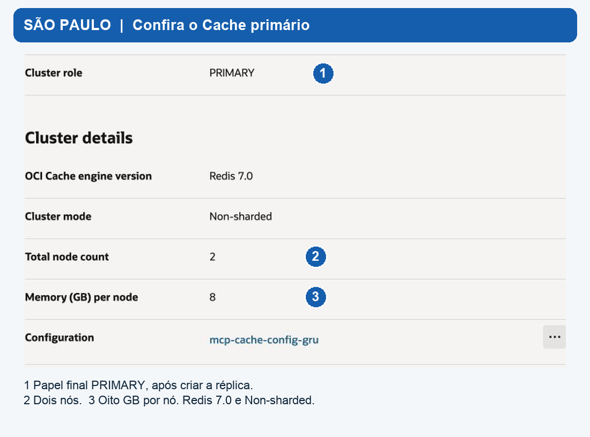

**Confira —** Redis 7.0, **Non-sharded**, **2 nós**, **8 GB por nó** e estado **Active**. Neste momento o papel pode ser **Standalone**: ele passa a **Primary** após a associação de Vinhedo no próximo passo. O print mostra o estado final com a replicação já criada.

**Resultado salvo —** `.runtime/state.json` recebe o identificador e o endpoint privado. O helper também cria o configuration set e os usuários. Dois nós são a configuração do lab; o console recomenda pelo menos três para alta disponibilidade em produção.

## Passo 15 Provisionar o Cache de Vinhedo

**ONDE — Terminal para criar | Console OCI em VINHEDO para conferir**

**Antes —** o passo 14 deve ter terminado com o Cache de São Paulo ativo.

**Faça agora**

1. **Confira o plano de Vinhedo:**

```bash
python scripts/cloud.py cache --region sa-vinhedo-1
```

2. **Crie o secundário associado ao primário:**

```bash
python scripts/cloud.py cache --region sa-vinhedo-1 --apply
```

3. **Abra Databases → OCI Cache → Clusters → mcp-context-vcp**, com Vinhedo selecionado.

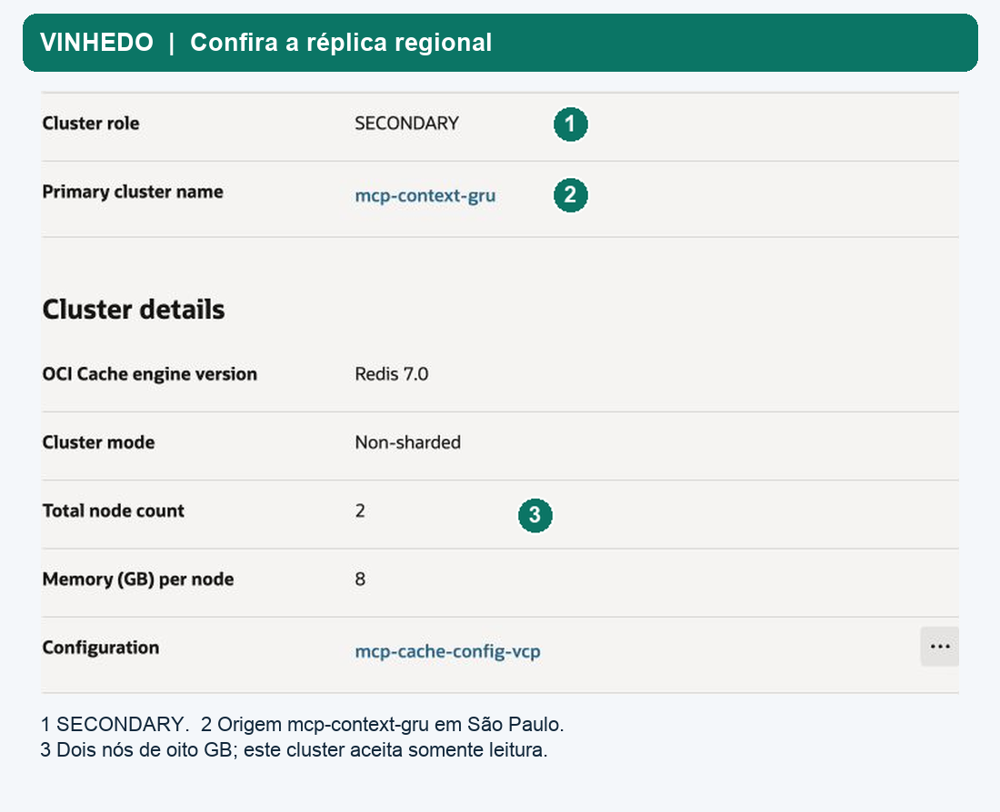

**Confira —** **Secondary**, origem **mcp-context-gru**, Redis 7.0, dois nós de 8 GB e Active. O script usa o identificador salvo no passo anterior; não é necessário digitá-lo de novo.

**O que foi criado —** um Cache regional somente leitura com replicação assíncrona nativa. Ele não é o Redis gravável utilizado pelo MCP secundário durante o ensaio; esse acesso ainda vai ao primário pelo caminho TLS do passo 22.

## Passo 16 Conferir replicação memória e usuários

**ONDE — Console OCI | Comece em SÃO PAULO e confira também VINHEDO**

**Faça agora**

1. **No Cache de São Paulo, abra Secondary clusters.** Confira `mcp-context-vcp` associado e Active.
2. **Abra o configuration set de cada região.** Confira os mesmos dois parâmetros:

| Parâmetro | Valor nos dois caches |
| --- | --- |
| reserved-memory-percentage | 35 |
| maxmemory-policy | volatile-lru |

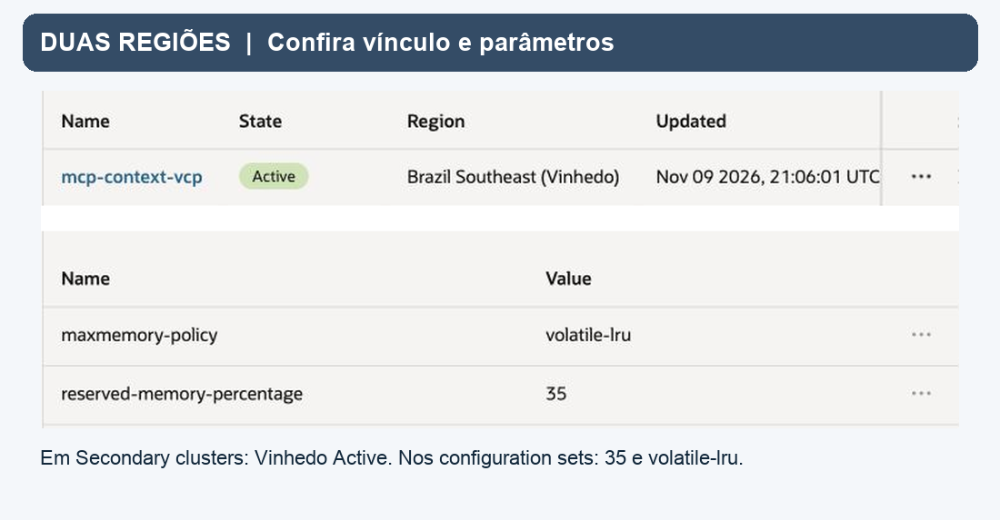

3. **Abra Users em cada Cache.** Confira `default` Off e `mcp` On nos dois. Em São Paulo, confira também `mcpweb` On.

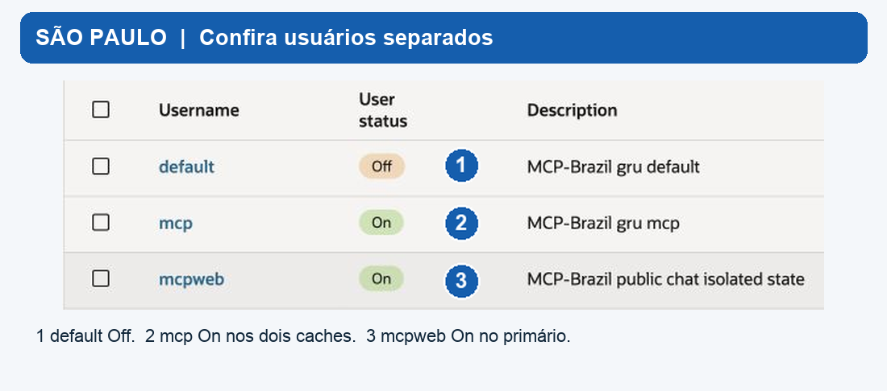

**Confira —** o usuário MCP acessa `mcp:*`; o usuário web acessa `racing:web:v1:*`. Configurações e ACLs são criadas explicitamente pelo helper; a replicação não as copia. As senhas não aparecem nos prints.

**Entenda o limite —** a réplica pode atrasar e não é promovida automaticamente. O histórico MCP não tem TTL; o estado da interface tem TTL de 24 horas. Veja a [referência do Cache](referencia-tecnica.md#7-criar-os-caches-e-a-replicação-nativa) para os detalhes de memória e retenção.

## Passo 17 Abrir o acesso administrativo temporário

**ONDE — Console OCI e dois terminais SSH | Um acesso por região**

**Faça agora**

1. **Crie um Bastion gerenciado por região**, na VCN correspondente. Restrinja a origem ao IP público atual do operador em `/32`.
2. **Crie uma sessão Port forwarding de uma hora**, para o IP privado da API OKE, porta **6443**.
3. **Permita 6443 no endpoint OKE a partir do endpoint privado do Bastion.**
4. **Copie o comando SSH do console.** Use a chave local protegida e abra a porta local **16443** para São Paulo e **26443** para Vinhedo. Mantenha os dois túneis abertos durante o deploy.

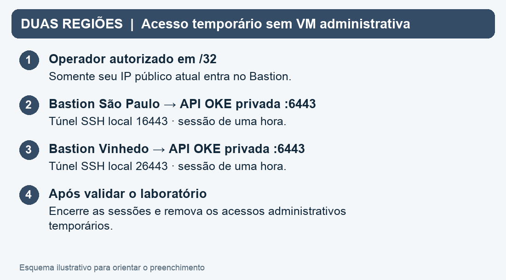

**Confira —** os túneis conectam. O Bastion não cria uma VM administrativa. Se a rede do operador bloquear o host SSH, use um caminho privado aprovado, conforme a [orientação de acesso](referencia-tecnica.md#9-acessar-as-apis-kubernetes-privadas). Não abra a API para a internet inteira.

## Passo 18 Conectar o kubectl aos dois OKE

**ONDE — Terminal do projeto | Túneis do passo 17 ainda abertos**

**Faça agora**

1. **Gere os arquivos de acesso:**

```bash
python scripts/private_access.py --region sa-saopaulo-1 --port 16443
python scripts/private_access.py --region sa-vinhedo-1 --port 26443
```

2. **Selecione os dois contextos e confira os nós:**

```bash
export KUBECONFIG="$PWD/.runtime/kubeconfig-gru:$PWD/.runtime/kubeconfig-vcp"
kubectl --context gru get nodes
kubectl --context vcp get nodes
```

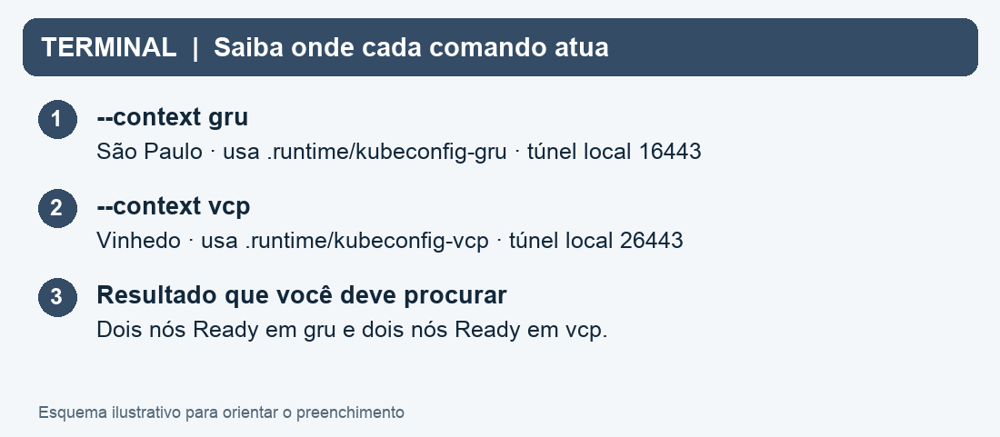

**Confira —** cada comando mostra **dois nós Ready**. `gru` significa São Paulo e `vcp` significa Vinhedo. Não prossiga se um contexto estiver apontando para outro ambiente.

**Guarde —** os kubeconfigs ficam em `.runtime/`. O helper mantém a CA e o nome TLS da API; não desative a validação do certificado para corrigir um túnel errado.

## Passo 19 Emitir o certificado HTTPS

**ONDE — Terminal | Domínio delegado à OCI no passo 11**

**Faça agora**

1. **Obtenha a autorização do titular do domínio** para aceitar os [termos da Let's Encrypt](https://letsencrypt.org/repository/) e publicar os nomes nos registros de certificados.
2. **Execute a emissão:**

```bash
python scripts/issue_public_tls.py --agree-terms
```

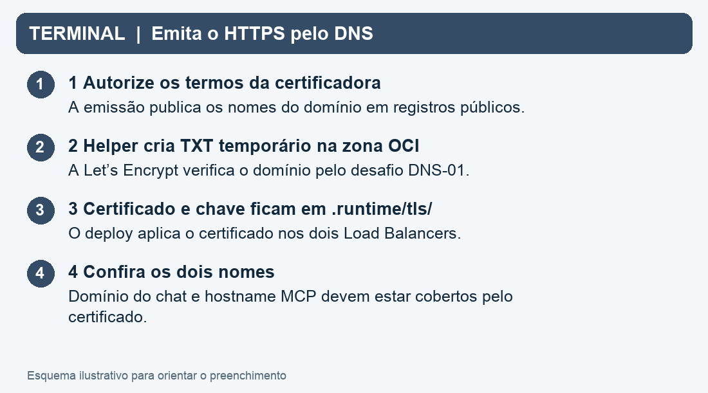

**Confira —** existem `.runtime/tls/fullchain.pem` e `.runtime/tls/server.key`. O certificado cobre o domínio do chat e o hostname MCP. A validação usa registros TXT temporários DNS-01; o helper remove apenas os registros do próprio desafio.

**Se falhar —** confira delegação, OCID da zona e permissão DNS. Não publique a chave privada nem aceite erros de certificado como resultado final. A renovação do pacote é manual e está na [referência de operação](referencia-tecnica.md#17-operar-diagnosticar-e-renovar).

## Passo 20 Construir e publicar as duas imagens

**ONDE — Terminal | Docker em execução**

**Faça agora**

1. **Crie os repositórios privados e obtenha o token temporário:**

```bash
python scripts/cloud.py registry --apply
```

2. **Construa e publique MCP e web:**

```bash
python scripts/lab.py build
```

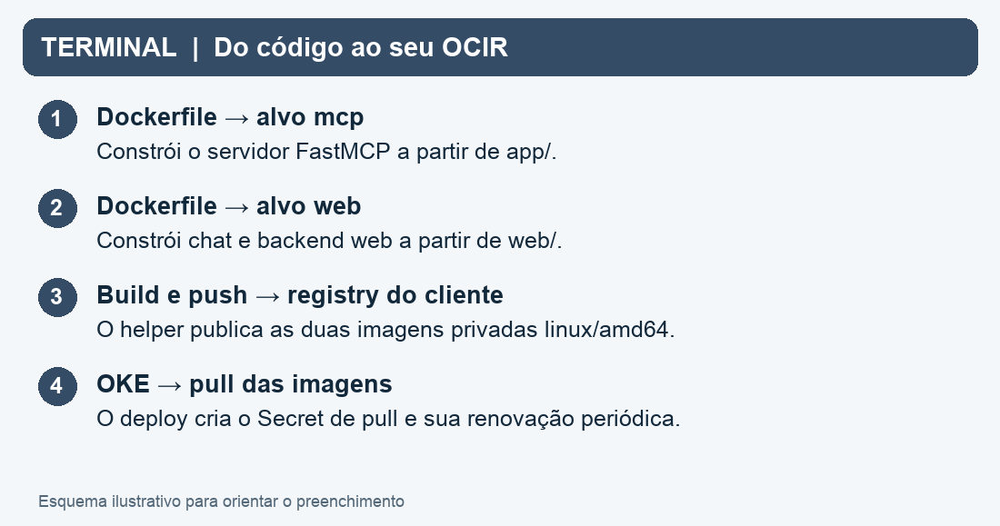

**Confira —** o build e o push terminam para as duas imagens no OCIR configurado pelo cliente. O Dockerfile tem os alvos `mcp` e `web`, usa Python oficial e executa sem root. Nenhuma imagem privada do autor é necessária.

**Para uma próxima versão —** aumente `image_version` em `config/lab.json`. Se o token expirar, repita o comando registry antes do push ou deploy. O build usa `linux/amd64`, conforme os workers x86 deste roteiro.

## Passo 21 Implantar MCP e chat em São Paulo

**ONDE — Terminal para aplicar | Console OCI em SÃO PAULO para conferir**

**Faça agora**

1. **Gere os manifestos e revise o arquivo privado informado:**

```bash
python scripts/lab.py render --region sa-saopaulo-1
```

2. **Aplique e descubra o IP do primeiro LB:**

```bash
python scripts/lab.py deploy --region sa-saopaulo-1 --apply
python scripts/lab.py discover
```

3. **Abra Networking → Load balancer** em São Paulo. Confira saúde e listeners. Se o IP ainda não apareceu, aguarde e repita discover.

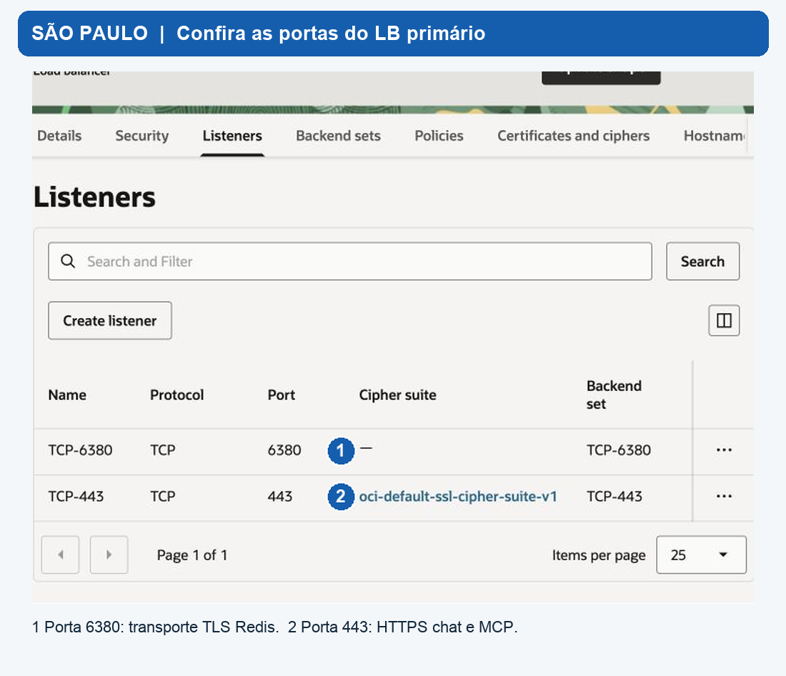

**Confira —** os três Deployments têm duas réplicas prontas; o LB está saudável e publica **443** e **6380**. O primeiro atende chat e MCP; o segundo transporta o TLS Redis. Um único LB atende essas portas em São Paulo.

**Atenção ao arquivo —** os YAMLs contêm Secrets, mesmo em Base64. Não os envie ao GitHub. O pacote mantém `ingress-ip-mode: Proxy` para que chamadas dos pods ao LB preservem o caminho TLS.

## Passo 22 Implantar Vinhedo e atualizar os dois lados

**ONDE — Console OCI para a rede | Terminal para aplicar**

**Faça agora**

1. **No LB de São Paulo, permita 6380 somente do NAT de Vinhedo em /32**, conforme o passo 08. Confira também o caminho interno até o NodePort 32380.
2. **Implante a aplicação secundária:**

```bash
python scripts/lab.py render --region sa-vinhedo-1
python scripts/lab.py deploy --region sa-vinhedo-1 --apply
python scripts/lab.py discover
```

3. **Reaplique nos dois OKE os endereços descobertos:**

```bash
python scripts/lab.py deploy --region sa-saopaulo-1 --apply
python scripts/lab.py deploy --region sa-vinhedo-1 --apply
python scripts/lab.py status
```

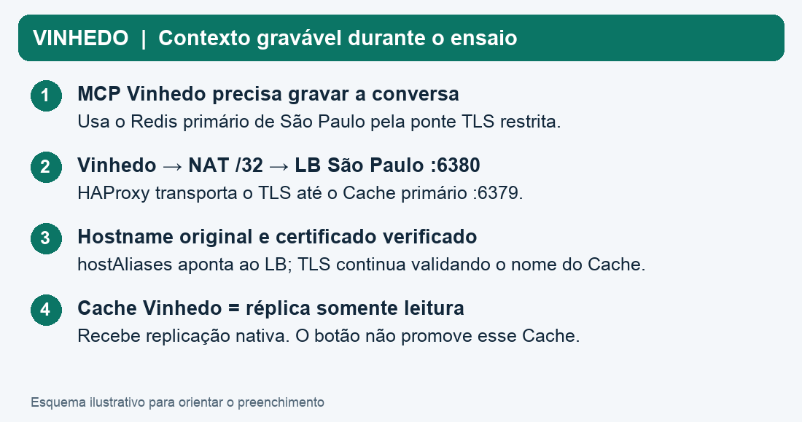

**Confira —** os dois LBs têm IP e MCP, web e HAProxy estão prontos nas duas regiões. O Redis de Vinhedo recebe replicação; o MCP de Vinhedo **grava no Redis primário** pela ponte TLS.

**Por que reaplicar —** os pods usam os novos IPs nas sondas e no controle entre regiões. A URL Redis conserva o hostname original do Cache; `hostAliases` aponta esse nome ao LB primário sem desativar a verificação TLS.

## Passo 23 Publicar o DNS com failover

**ONDE — Terminal para criar | Console OCI para conferir**

**Faça agora**

1. **Confira o plano e aplique a política:**

```bash
python scripts/cloud.py dns
python scripts/cloud.py dns --apply
```

2. **Abra Networking → DNS → Traffic management steering policies.** Confira FAILOVER e prioridade São Paulo antes de Vinhedo.
3. **Abra o Health Check associado.** Confira HTTPS 443, caminho `/readyz`, Host do MCP e intervalo de 10 segundos.

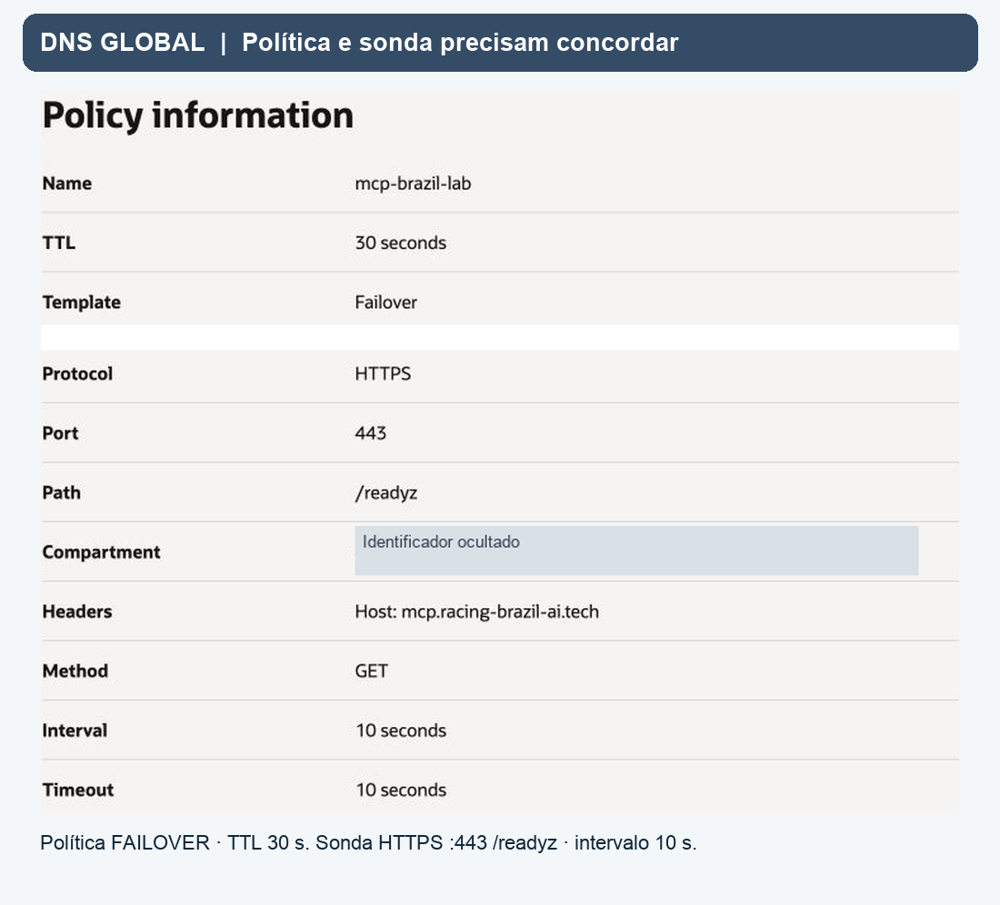

4. **Substitua o domínio abaixo pelo seu e teste:**

```bash
dig +short seu-dominio.com
dig +short mcp.seu-dominio.com
curl https://seu-dominio.com/chat/
curl https://mcp.seu-dominio.com/readyz
```

**Confira —** DNS resolve, HTTPS é válido e `/readyz` responde com sucesso. O TTL é de 30 segundos. O pacote não configura um contador de duas ou três falhas consecutivas; a convergência pode interromper chamadas. A sonda verifica MCP e Cache, sem executar inferência GenAI.

## Passo 24 Ensaiar o failover e concluir a entrega

**ONDE — Navegador | Participantes e apresentador em perfis separados**

**Faça agora**

1. **Abra `https://seu-dominio.com/chat/` como participante.** Clique **Iniciar o contexto → Enviar**. Aguarde a resposta de São Paulo.
2. **Em outro perfil, abra `/chat/presenter`.** Use a senha local de `.runtime/presenter-access.txt` e clique **Interromper São Paulo**.
3. **No participante, mantenha a mesma conversa.** Clique **Testar a memória → Enviar** e aguarde a reconexão.
4. **Confira Vinhedo na resposta, quatro mensagens e revisão 2.** A resposta deve recuperar Silvio, Q3, conta 4022 e o resultado **20%**, sem repetir esses dados na pergunta.
5. **Clique Restaurar / encerrar** no apresentador e confirme duas réplicas MCP prontas em São Paulo.

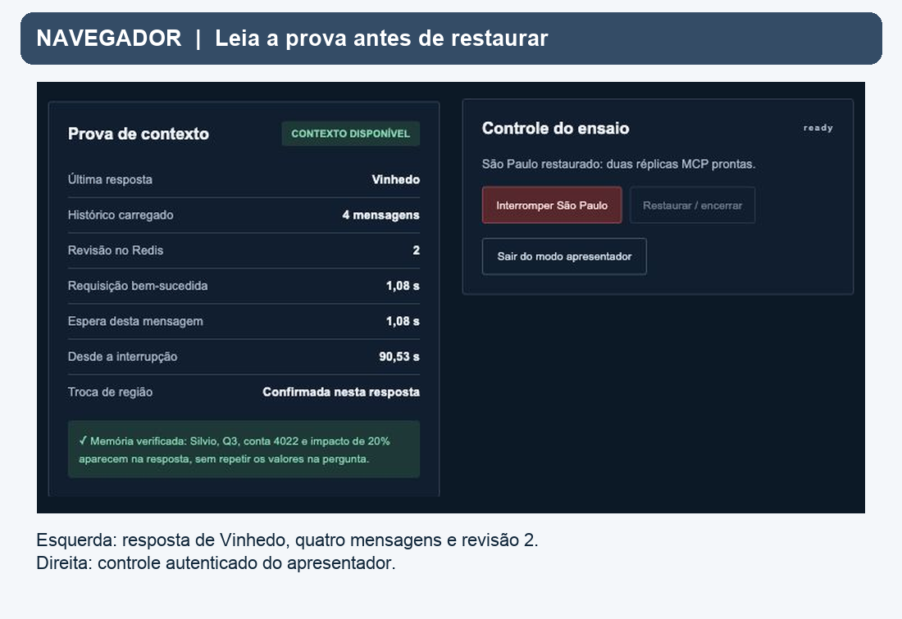

**Confira —** dois participantes em perfis separados mantêm conversas distintas e nenhum deles consegue interromper o ambiente. Os controles exigem autenticação no servidor. A restauração automática está prevista para cinco minutos e roda no OKE.

**Conclua —** encerre e remova os Bastions e acessos administrativos temporários. Entregue domínio, manual do usuário e senha do apresentador por canal privado. Recursos provisionados continuam cobrando mesmo sem uso; o botão de interrupção não para essa cobrança.

## Verificação técnica adicional e limites do laboratório

**No Terminal, valide o pacote sem criar recursos cloud:**

```bash
python -m unittest discover -s tests -v
```

**Para conferir uma conversa na réplica nativa de Vinhedo**, copie o UUID da sessão e substitua o marcador:

```bash
python scripts/verify_replication.py --session-id UUID_DA_SUA_SESSAO --min-revision 2
```

O Job temporário lê a réplica e mostra somente contagem, revisão e papel Redis, sem imprimir mensagens. Ele é removido ao final. Essa verificação é separada do chat, que usa o primário gravável.

**O ensaio valida a falha dos pods MCP de São Paulo.** Ele não comprova zero downtime, RPO zero regional nem recuperação total abaixo de dois segundos. A inferência e o Cache gravável permanecem em São Paulo; a réplica é assíncrona e não é promovida pelo botão. Os tempos reais do ensaio de referência estão no [registro de validação](validacao-referencia.json).

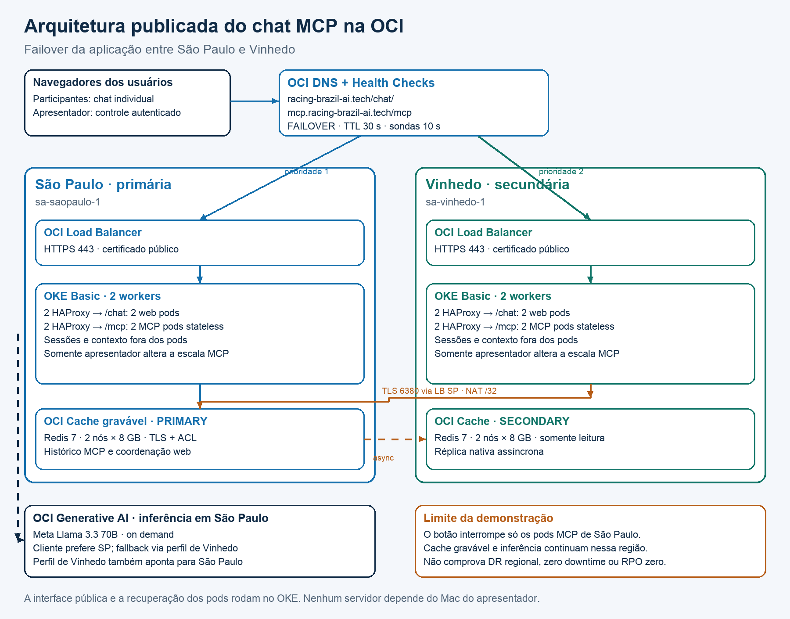

**Para continuar:** [manual do usuário](manual-usuario.md), [referência de rede e operação](referencia-tecnica.md), [recuperação manual e renovação TLS](referencia-tecnica.md#17-operar-diagnosticar-e-renovar) e [procedimento de desativação](referencia-tecnica.md#19-encerrar-os-acessos-e-controlar-os-custos). O código parametrizado tem validação automatizada; uma implantação nova precisa do ensaio completo na conta do cliente.
