# Manual técnico de implantação do laboratório MCP na OCI

Este manual ensina uma pessoa técnica com conhecimento inicial de OCI a reproduzir o laboratório em sua própria tenancy. Ele apresenta a arquitetura, a preparação de rede e identidade, a criação dos caches, o deploy dos containers e a validação funcional. Leia as etapas na ordem: cada uma produz dados usados na seguinte.

O ambiente de referência foi implantado em São Paulo e Vinhedo. Os prints mostram esse ambiente real, com identificadores privados ocultados. O pacote deste repositório usa configuração externa para outra tenancy; não contém as credenciais, os OCIDs reais ou o endereço do registry privado do autor.

**Escopo validado.** O MCP primário pode ser interrompido e o secundário retoma a conversa usando o Redis gravável compartilhado. Isso não equivale a uma recuperação integral de São Paulo: a inferência e o Cache gravável continuam nessa região. A réplica de Vinhedo é assíncrona e não é promovida automaticamente. Zero downtime, RPO zero regional e recuperação total abaixo de dois segundos não foram demonstrados.

O ambiente publicado foi testado em cloud. A versão parametrizada do repositório tem testes de aplicação e de geração dos manifestos; criar uma tenancy nova com este pacote é uma etapa de implantação do cliente, não uma validação já executada na conta dele.

## 1 Entender os serviços e o caminho das requisições


**Figura 1.** O navegador usa o domínio público. Os dois OKE hospedam web, HAProxy e MCP; o estado gravável e a execução GenAI permanecem em São Paulo.

| Componente | Configuração de referência | Responsabilidade |
| --- | --- | --- |
| OKE | Dois clusters Basic com dois managed workers cada | Executar containers; os quatro workers são instâncias Compute do próprio OKE. |
| MCP | Duas réplicas por região | Ferramentas ask_oci_genai e analyze_resilience_status; estado externo. |
| Web | Duas réplicas por região | Chat público, sessão individual e autenticação do apresentador. |
| HAProxy | Duas réplicas por região | Encaminhar /mcp e /chat e transportar TLS Redis na região primária. |
| OCI Load Balancer | Um por região, 10 Mbps mínimo e máximo no lab | Publicar HTTPS 443; no primário também transportar Redis TLS 6380. |
| OCI Cache | Redis 7.0, non-sharded, dois nós de 8 GB por região | Primário gravável e secundário somente leitura com replicação nativa. |
| OCI GenAI | Meta Llama 3.3 70B on demand | Inferência em São Paulo; perfil de roteamento em Vinhedo apontando para São Paulo. |
| OCI DNS e Health Checks | FAILOVER, TTL 30 s, HTTPS a cada 10 s | Selecionar o IP regional conforme a saúde do MCP. |
| OCIR | Imagens privadas | Distribuir as imagens MCP e web. |

O frontend TLS termina no Load Balancer. O tráfego HTTP interno segue ao HAProxy e aos Services Kubernetes. O caminho Redis é diferente: a porta 6380 do LB primário transporta o TLS até o Cache, sem remover sua proteção. O cliente valida o certificado pelo hostname original do Cache.

Não há cluster dedicado de IA, Autonomous Database, Resource Manager ou VM administrativa adicional neste desenho. IAM, VCNs, sub-redes, gateways, volumes dos workers, Cache, Load Balancers, registry e tráfego fazem parte do custo do laboratório. Health Checks de 10 segundos são da modalidade Premium. Consulte preços e limites da sua tenancy antes de provisionar.

## 2 Preparar conta ferramentas e diretório

Você precisa de uma tenancy com assinatura das regiões `sa-saopaulo-1` e `sa-vinhedo-1`, um compartment exclusivo e cotas para quatro workers, dois Load Balancers e dois caches. Um administrador deve permitir a criação dos recursos e realizar a etapa IAM se o operador não puder gerenciar dynamic groups e políticas.

Use Linux, macOS ou WSL com Python 3.12, OCI CLI, kubectl, Docker com daemon em execução e dig. Instale pelas distribuições oficiais indicadas nas referências. Os comandos deste manual são para um shell Bash compatível; não cole os exemplos diretamente no PowerShell sem adaptação.

```bash
git clone https://github.com/SilvioCristiano/Resilient-HA-OCI-MCP.git
cd Resilient-HA-OCI-MCP
python3 -m venv .venv
source .venv/bin/activate
python -m pip install -r requirements-tools.txt
oci setup config
oci iam region-subscription list
kubectl version --client=true
docker version
```

O arquivo `~/.oci/config` e a chave de assinatura pertencem ao operador. Não os copie para os containers nem para o GitHub. O diretório `.runtime/` será criado com os dados locais de implantação e está no `.gitignore`.

Permissões de Cache usam a família IAM `redis-family`. O operador de rede precisa administrar os recursos do compartment, e o operador OKE precisa criar clusters e node pools. Use o administrador para conceder somente os acessos necessários. A política dos containers criada pelo pacote permite Chat GenAI no compartment e leitura dos dois repositórios; ela não concede gerenciamento de clusters dedicados de IA.

## 3 Criar os dois OKE pelo console

No console, selecione São Paulo e abra **Developer Services → Kubernetes Clusters OKE**. Clique em criar cluster e escolha o fluxo Quick Create. Se o fluxo inicialmente indicar Enhanced, use a opção de cluster Basic disponível na revisão, conforme a documentação da sua versão do console.

1. Escolha o compartment exclusivo do laboratório.
2. Use um nome como `mcp-resilience-gru`.
3. Selecione uma versão Kubernetes suportada e compatível com kubectl.
4. Use managed nodes, não virtual nodes.
5. Configure dois workers privados. Para o pacote Docker fornecido, escolha workers x86 AMD64; uma shape Flex x86 adequada à cota é um exemplo, não um requisito de preço ou capacidade.
6. Prefira a API Kubernetes privada, como no ambiente de referência.
7. O cluster de referência utiliza VCN-native. Nesse modo, confira também a sub-rede e as regras dos pods. Flannel é uma alternativa suportada pelo OKE, mas muda o planejamento de rede; não misture instruções dos dois modos.
8. Revise os recursos gerados, o tipo Basic e o custo; somente então confirme a criação.
9. Aguarde o cluster Active e os dois workers prontos.
10. Repita em Vinhedo, com nome `mcp-resilience-vcp` e dois workers.

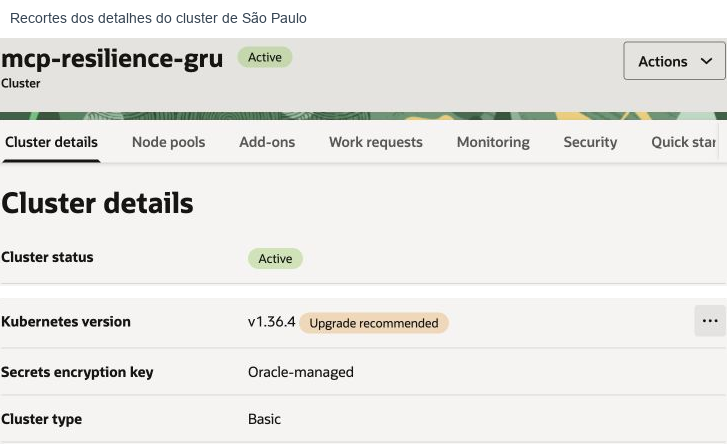

**Figura 2.** Detalhes reais do cluster de referência. Em sua conta, use os recursos do compartment do cliente.

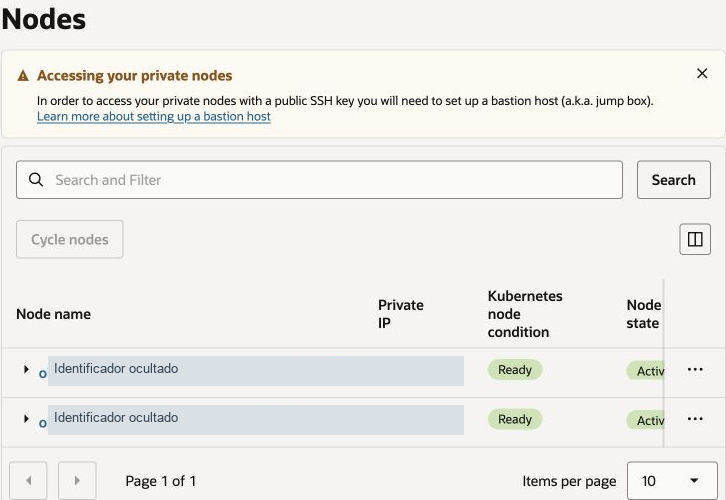

**Figura 3.** Os dois workers aparecem Ready no node pool. Os nomes e IPs foram ocultados. Se a lista de node pools parecer vazia, confira o filtro de compartment: na referência os workers estavam em Labs, enquanto o cluster estava no compartment raiz. Em sua conta, prefira manter os recursos no compartment do cliente. Não confunda esses workers Compute com VMs administrativas adicionais.

Anote em cada região: OCID do cluster, VCN, sub-rede pública de LB, sub-rede privada de workers, CIDR real dos workers, IP público do NAT Gateway e os dois OCIDs de instância dos workers. Os OCIDs dos workers aparecem no node pool ou nas instâncias correspondentes.

O Quick Create pode gerar CIDRs iguais nas duas regiões. O laboratório de referência também tinha sobreposição; por isso usa a ponte TLS restrita ao NAT de Vinhedo, sem peering entre VCNs. O arquivo de exemplo contém CIDRs ilustrativos: substitua-os pelos reais. Para um desenho futuro com peering, planeje CIDRs que não se sobreponham.

## 4 Preparar a rede do Cache e dos Load Balancers

Crie um NSG de Cache em cada VCN. Neste laboratório, o Cache pode utilizar a própria sub-rede privada dos workers, como na referência. Uma sub-rede privada específica também é válida se tiver as rotas e permissões necessárias.

No NSG do Cache, permita TCP 6379 somente a partir do CIDR dos workers daquela região. Anote o OCID do NSG e o OCID da sub-rede escolhida para `cache_nsg_id` e `cache_subnet_id`.

O Service fornecido usa gerenciamento automático de security lists desativado. Portanto, configure explicitamente os caminhos abaixo, preservando as regras de funcionamento do OKE geradas na criação do cluster.

| Origem | Destino | Porta TCP | Motivo |
| --- | --- | --- | --- |
| Internet | LB público de cada região | 443 | Chat e MCP HTTPS. |
| NAT público de Vinhedo em /32 | LB público de São Paulo | 6380 | Redis TLS compartilhado. Nenhuma origem adicional. |
| Sub-rede do LB regional | Workers da mesma região | 32443 | NodePort do tráfego HTTPS já terminado no LB. |
| Sub-rede do LB de São Paulo | Workers de São Paulo | 32380 | NodePort do transporte Redis TLS. |
| Sub-rede do LB regional | Workers da mesma região | 10256 | Verificação de saúde de nodes utilizada pelo LB. |
| Workers locais | Cache da mesma região | 6379 | Acesso privado ao Cache e conferência da réplica. |
| Workers de Vinhedo via NAT | LB público de São Paulo | 6380 | Saída da aplicação secundária para o Redis gravável. |

Em **Networking → Virtual cloud networks**, abra a VCN e suas sub-redes. Ajuste os NSGs ou security lists associados aos destinos. As regras são stateful neste exemplo. O NAT permite saída dos workers privados para OCIR e APIs OCI por HTTPS. As regras internas completas de OKE dependem do tipo de rede; confira a referência oficial antes de restringi-las.

Não exponha Redis 6379 à internet. A porta 6380 não é uma segunda instância de Cache: é uma entrada TLS no mesmo LB primário, aceita somente do NAT de Vinhedo. Ela mantém dependência da região primária.

## 5 Preparar o modelo e o domínio

Em **Analytics and AI → Generative AI**, confirme um modelo Meta Llama 3.3 70B on demand disponível em São Paulo e copie seu OCID. O código usa `GenericChatRequest` para esse modelo. Trocar apenas o OCID para um modelo de outra família, como Cohere, pode exigir adaptar o tipo da requisição.

Em Vinhedo, crie um routing profile para o mesmo modelo e selecione **somente São Paulo** como destino autorizado, acompanhando o laboratório de referência. Copie o OCID do perfil. Não crie Dedicated AI Cluster nem endpoint dedicado. Um perfil em Vinhedo não significa inferência local em Vinhedo; a execução continua em São Paulo.

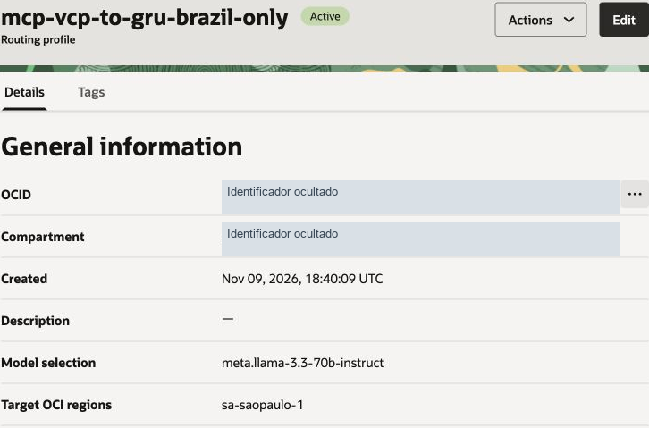

**Figura 4.** Use o perfil para conferir modelo e destino. A disponibilidade regional muda; valide-a na implantação do cliente.

Para acesso público, crie uma zona **pública** OCI DNS para o domínio do cliente. No registrador, como HostGator, delegue os nameservers aos servidores informados pela zona OCI. Não substitua registros de um domínio que já hospede outros serviços sem planejar a migração. Uma zona privada sozinha não atende os navegadores do público na internet.

## 6 Preencher a configuração e gerar segredos

```bash
cp config/lab.example.json config/lab.json
python scripts/lab.py init
```

Edite `config/lab.json`. Cada OCID e hostname deve pertencer à conta do cliente. Preencha o compartment, a home region IAM, domínio, hostname MCP, zona DNS, modelo, routing profile, namespace OCIR e os dados regionais coletados.

Os campos `context` podem continuar `gru` e `vcp`. `workers` deve conter exatamente dois OCIDs de instância por região. `nat_ip` é o IP público de saída da região, usado para revisar a regra /32. `worker_cidr` é o CIDR real, não necessariamente o ilustrado no arquivo.

O comando init gera tokens e senhas em `.runtime/secrets.json`, modo 600. A senha do apresentador fica em `.runtime/presenter-access.txt`. O navegador nunca recebe o token MCP ou as senhas Redis. Não publique o diretório `.runtime/`, os kubeconfigs ou os YAMLs gerados: eles contêm credenciais, mesmo quando codificadas em Base64.

```bash
python scripts/cloud.py iam
python scripts/cloud.py iam --apply
```

O primeiro comando mostra a fase sem alterar recursos. O segundo cria um dynamic group restrito aos quatro workers e a política de inferência e leitura OCIR. Aguarde a propagação antes de testar os pods. O pacote recusa reaproveitar um grupo com escopo diferente, em vez de ampliar permissões automaticamente.

## 7 Criar os caches e a replicação nativa

```bash
python scripts/cloud.py cache
python scripts/cloud.py cache --apply
```

O script cria primeiro o Cache de São Paulo, aguarda Active e usa seu identificador como origem na criação do secundário em Vinhedo. Ele grava IDs e endpoints em `.runtime/state.json`. Se a operação ainda estiver em andamento, aguarde e execute a mesma fase novamente; não crie clusters adicionais para substituir uma operação pendente.

| Campo | São Paulo | Vinhedo |
| --- | --- | --- |
| Engine | Redis 7.0 | Redis 7.0 |
| Cluster mode | NONSHARDED | NONSHARDED |
| Node count do lab | 2 | 2 |
| Memory por node | 8 GB | 8 GB |
| Papel | PRIMARY | SECONDARY |
| Escrita da aplicação | Permitida | Não utilizada nem permitida como secundário |
| Configuration set | Custom próprio da região | Custom próprio da região |
| reserved-memory-percentage | 35 | 35 |
| maxmemory-policy | volatile-lru | volatile-lru |

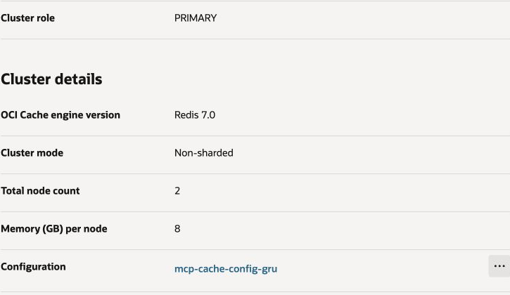

**Figura 5.** Capacidade e papel do primário. O serviço sinaliza que um ou dois nós podem causar perda de dados e recomenda pelo menos três para HA. Dois nós por região são a configuração deste laboratório, não uma recomendação de produção.

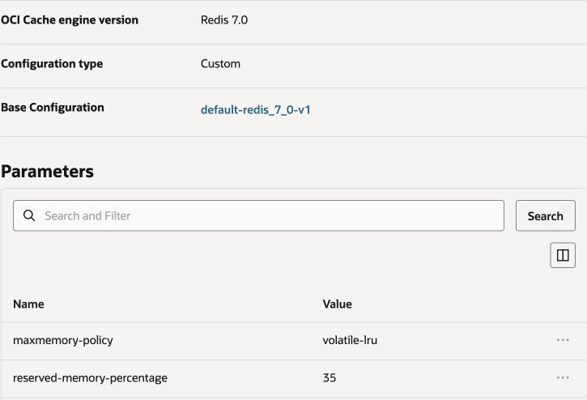

**Figura 6.** Os dois parâmetros devem coincidir entre as regiões. A reserva de 35% oferece espaço operacional para o mecanismo. `volatile-lru` permite descartar chaves com TTL; as chaves de conversa do MCP não têm TTL e não são candidatas a essa política. Isso não transforma memória em armazenamento durável nem garante ausência de falhas por falta de memória.

O serviço replica dados de forma assíncrona por rede privada OCI. Essa replicação é uma função gerenciada; não é implementada por um loop Python copiando mensagens. Não é necessário expor a porta 6380 para a replicação nativa: essa porta é somente para o acesso gravável do MCP de Vinhedo ao primário.

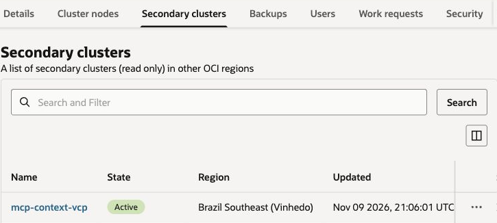

**Figura 7.** Em São Paulo, a aba Secondary clusters mostra o Cache de Vinhedo associado e ativo.

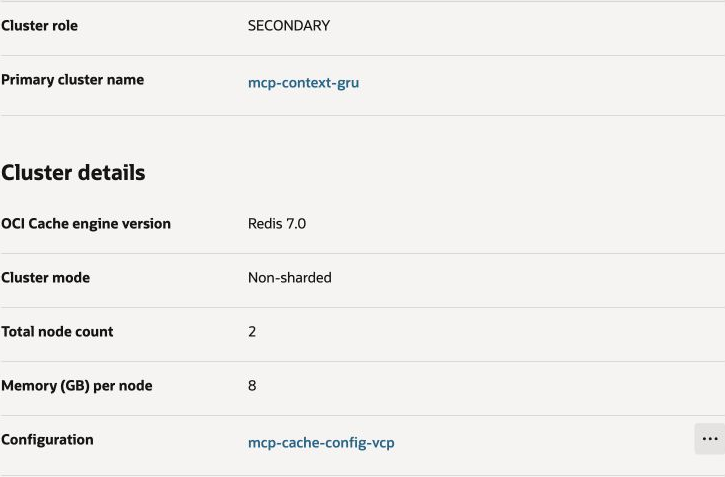

**Figura 8.** No secundário, confira SECONDARY e o nome do primário. Não confunda o campo Primary endpoint, que identifica o endpoint do próprio cluster regional, com autorização para escrita em um cluster de papel SECONDARY.

A sincronização inicial recebe o conjunto de dados e depois acompanha alterações. Pode haver atraso. A confirmação de escrita no primário pode ocorrer antes de a alteração chegar à réplica. Uma perda regional pode, portanto, perder as alterações mais recentes.

## 8 Conferir usuários ACL e segurança do Cache

O script cria usuários separados, com senhas distintas para MCP e web. As configurações e ACLs não são copiadas automaticamente pela replicação; os usuários necessários são criados explicitamente em cada região.

| Usuário | Onde é usado | Permissões |
| --- | --- | --- |
| default | Desativado nos dois caches | Status OFF impede uso do acesso padrão. |
| mcp | Nos dois caches | Prefixo mcp:*; GET, SET, WATCH, UNWATCH, MULTI, EXEC, PING, INFO e nome do cliente. |
| mcpweb | No primário | Prefixo racing:web:v1:*; operações necessárias a sessões, filas, limites e coordenação web. |

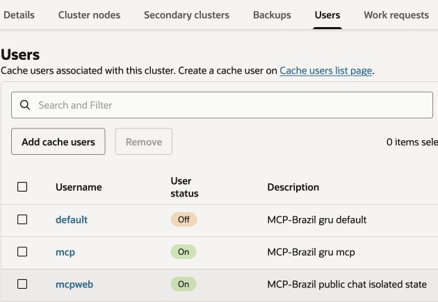

**Figura 9.** Usuários reais associados ao primário. A imagem não contém senhas. O usuário mcpweb não precisa de acesso às chaves mcp:*.

O MCP usa `rediss://` com validação obrigatória de certificado. O histórico é gravado por comparação de versão: WATCH e transação impedem que um turno concorrente substitua silenciosamente outro. Uma falha de Cache gera erro; o servidor não inventa um histórico vazio para aparentar sucesso.

O estado web tem TTL de 24 horas para reapresentação e coordenação. O estado autoritativo do modelo fica nas chaves MCP sem TTL. Para produção, defina retenção, exclusão, durabilidade e isolamento adequados ao cliente; este laboratório não fornece identidade empresarial individual aos participantes.

## 9 Acessar as APIs Kubernetes privadas

Crie um Bastion gerenciado em cada região, na VCN do respectivo OKE. Restrinja a lista de origens ao IP público atual do operador em /32. Crie uma sessão Port forwarding para o IP privado da API Kubernetes e a porta 6443, com duração de uma hora. O serviço Bastion não é uma VM Compute.

Confirme que o NSG ou security list do endpoint OKE aceita TCP 6443 a partir do endpoint privado do Bastion. Copie o comando SSH apresentado pelo console e use uma chave local protegida. Abra a porta local 16443 para São Paulo e 26443 para Vinhedo.

```bash
python scripts/private_access.py --region sa-saopaulo-1 --port 16443
python scripts/private_access.py --region sa-vinhedo-1 --port 26443
export KUBECONFIG="$PWD/.runtime/kubeconfig-gru:$PWD/.runtime/kubeconfig-vcp"
kubectl --context gru get nodes
kubectl --context vcp get nodes
```

Mantenha os dois comandos SSH abertos durante o deploy. O helper conserva a CA original e configura `tls-server-name` para o endpoint privado; ele não usa `insecure-skip-tls-verify`.

Se sua rede bloquear o host SSH de uma região, use um caminho privado aprovado, como Cloud Shell com rede privada na VCN correspondente. A referência precisou de um túnel temporário em pod do OKE de São Paulo para administrar Vinhedo. Isso foi uma solução operacional da rede daquele computador; não é um componente permanente da aplicação.

Se optar por API pública na criação do OKE, restrinja o ingresso ao operador /32 e use `private_access.py --direct` sem --port. Essa é uma alternativa de acesso administrativo, diferente do endpoint privado usado na referência.

## 10 Emitir o certificado HTTPS público

O domínio deve estar delegado corretamente à zona OCI antes desta etapa. Leia os termos da Let's Encrypt e obtenha a autorização do proprietário do domínio. A emissão divulga os nomes nos registros públicos de certificados.

```bash
python scripts/issue_public_tls.py --agree-terms
```

O script usa DNS-01: adiciona somente os TXT exatos do desafio, valida os nomes do domínio e do MCP, emite o certificado e remove os TXT temporários. Não abre porta 80. As chaves ficam em `.runtime/tls/`, modo 600.

Uma CA privada também pode ser usada em laboratório interno, mas o público precisaria confiar nela em seus dispositivos. O caminho principal deste pacote utiliza certificado público para evitar esse requisito nos navegadores.

## 11 Construir as imagens e publicá las no OCIR

```bash
python scripts/cloud.py registry --apply
python scripts/lab.py build
```

São criados dois repositórios privados no OCIR do cliente. O comando de registry obtém um token efêmero e grava a configuração Docker em `.runtime/`, sem imprimir o token. Repita essa fase se precisar publicar depois da expiração.

O Dockerfile tem dois alvos: `mcp` executa `app.server`; `web` executa a interface e seu backend de acesso ao MCP. Os dois executam como UID 10001, sem root. Nenhuma imagem privada do autor é necessária: os alvos são construídos a partir do código deste repositório e da imagem oficial Python.

O helper usa `linux/amd64`, correspondente aos workers x86 do exemplo. Para workers ARM64, revise a plataforma de build e a compatibilidade das imagens. Aumente `image_version` para uma nova versão em cada publicação; não sobrescreva uma versão já implantada e espere que IfNotPresent baixe outro conteúdo.

No ambiente original, o build foi feito em pod temporário BuildKit nos workers existentes porque não havia Docker local utilizável. O pacote do cliente utiliza Docker no computador técnico ou em CI; o resultado implantado é equivalente. O workflow GitHub valida testes e builds sem acessar OCI ou publicar imagens automaticamente.

## 12 Implantar São Paulo e descobrir seu Load Balancer

```bash
python scripts/lab.py render --region sa-saopaulo-1
python scripts/lab.py deploy --region sa-saopaulo-1 --apply
python scripts/lab.py discover
```

Revise os YAMLs privados antes do comando deploy. O IP externo do Service pode levar alguns minutos para aparecer; repita discover até São Paulo ter um IP. Não edite a interface do cliente para colar o IP do autor.

Esta fase cria namespace, Secrets, ConfigMaps, Deployments, Services, PDBs, ServiceAccounts, RBAC e CronJobs. Ela solicita um único Load Balancer regional. O retorno de rollout pronto significa pods disponíveis; ainda é necessário testar a inferência, o DNS e o certificado.

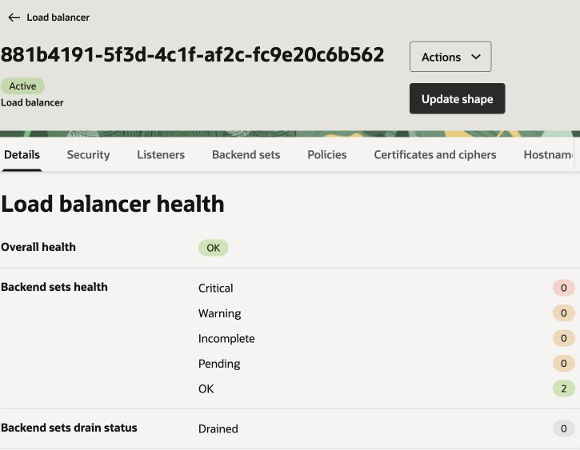

**Figura 10.** Reutilize o LB regional para /chat e /mcp. O transporte Redis usa uma porta adicional apenas em São Paulo.

O LB usa a anotação **oci.oraclecloud.com/ingress-ip-mode: Proxy**. Ela é importante: no modo VIP, chamadas de um pod ao IP público do próprio LB podem passar por um caminho que contorna o frontend TLS e quebra a negociação HTTPS. O pacote mantém Proxy explicitamente.

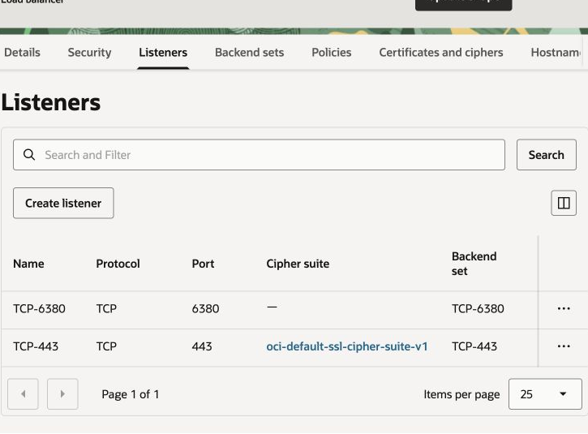

**Figura 10b.** O listener 443 tem cipher suite TLS; o listener 6380 é transporte TCP do TLS Redis. Ambos pertencem ao mesmo LB de São Paulo.

## 13 Implantar Vinhedo e atualizar os endereços compartilhados

Depois de descobrir o IP primário, configure a regra 6380 no LB de São Paulo aceitando somente o NAT de Vinhedo /32. O Cache gravável continua protegido por senha, ACL e TLS.

```bash
python scripts/lab.py render --region sa-vinhedo-1
python scripts/lab.py deploy --region sa-vinhedo-1 --apply
python scripts/lab.py discover
python scripts/lab.py deploy --region sa-saopaulo-1 --apply
python scripts/lab.py deploy --region sa-vinhedo-1 --apply
python scripts/lab.py status
```

Os últimos dois deploys aplicam aos dois lados os IPs descobertos, usados pelas sondas e pelo controle entre regiões. São Paulo precisa existir antes de Vinhedo porque o cliente Redis secundário utiliza o IP do LB primário na entrada TLS 6380.

O hostname da URL Redis continua sendo o hostname original do Cache. `hostAliases` faz esse nome apontar ao IP do LB primário nos pods de Vinhedo. Assim o cliente conecta ao caminho de rede necessário, mas verifica o certificado com o nome correto. Não substitua isso por desativação da validação TLS.

## 14 Publicar o DNS com failover

```bash
python scripts/cloud.py dns
python scripts/cloud.py dns --apply
dig +short seu-dominio.com
dig +short mcp.seu-dominio.com
curl https://seu-dominio.com/chat/
curl https://mcp.seu-dominio.com/readyz
```

Substitua os domínios pelos configurados. O script recusa substituir registros A ou uma política de outro serviço. Ele cria um monitor HTTPS para os dois IPs e uma política FAILOVER com prioridade para São Paulo; o domínio do chat e o hostname MCP recebem vínculos com a mesma política.

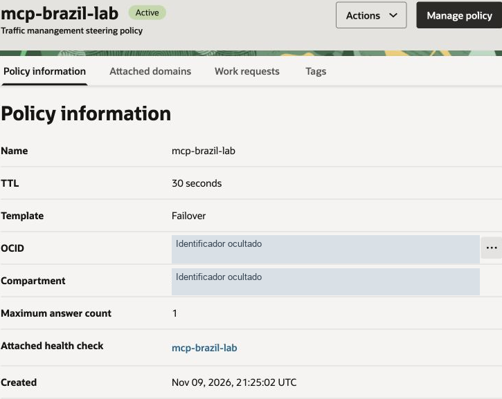

**Figura 11.** Primário e secundário são respostas de uma política com monitor de saúde. A delegação no registrador aponta a zona aos nameservers OCI, não diretamente a um IP de LB.

O monitor consulta `/readyz` do MCP com Host do hostname MCP, a cada dez segundos. O TTL é de trinta segundos. Não há um campo de duas ou três falhas consecutivas configurado pelo pacote: esse parâmetro não está exposto no modelo de monitor utilizado. Os tempos reais incluem convergência e cache DNS.

Esse monitor verifica a prontidão MCP e seu acesso ao estado; ele não realiza uma inferência GenAI nem cobre sozinho uma falha exclusiva de todos os pods web. Uma produção que precise proteger também esse caso deve definir uma verificação composta de saúde.

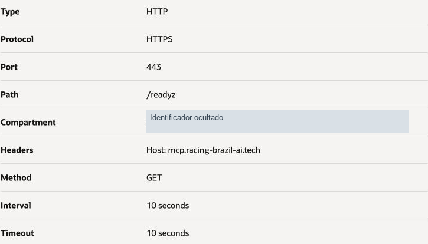

**Figura 12.** Sonda HTTPS na porta 443, caminho /readyz, Host MCP e intervalo de dez segundos. O compartment foi ocultado.

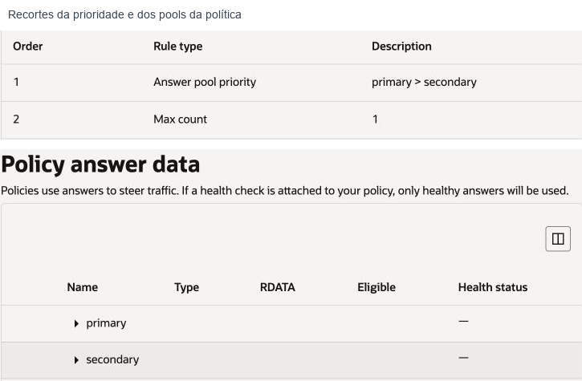

**Figura 13.** A política prioriza primary antes de secondary. O estado de saúde muda durante o ensaio.

## 15 Entender as sessões e o controle do apresentador

O navegador recebe cookie de sessão assinado, Secure, HttpOnly e SameSite. O backend ignora session_id enviado no corpo ou query e usa somente a identidade do cookie. CSRF e Origin são verificados em operações de escrita. O token MCP fica no Secret Kubernetes.

A senha do apresentador autentica outro cookie, válido por quatro horas. Ocultar os botões não é a proteção principal: as rotas administrativas verificam autorização no servidor e recusam participantes com HTTP 403.

O ServiceAccount de São Paulo só lê o Deployment `mcp-server` e altera seu sub-recurso `scale`, no namespace `mcp-lab`. Os controles não possuem um campo livre para executar comandos Kubernetes.

Quando o frontend de Vinhedo recebe um comando autorizado, encaminha-o ao frontend primário por HTTPS com HMAC, validade de trinta segundos e nonce de uso único. Isso não abre uma API Kubernetes pública.

Antes de escalar o MCP a zero, o controlador grava no Redis o estado da operação e o prazo de restauração de cinco minutos. Os pods web primários reconciliam esse estado; um CronJob executa a mesma recuperação a cada minuto como proteção adicional. Essa recuperação continua sem Mac e sem Bastion, mas depende do Cache, da API OKE e de um executor funcional.

## 16 Validar contexto isolamento e replicação

Primeiro execute os testes locais. Eles não criam recursos cloud.

```bash
python -m unittest discover -s tests -v
```

Abra o chat em dois perfis de navegador. Em um, use o exemplo Silvio Q3 conta 4022 do manual do usuário. No outro, informe outro nome fictício e outro marcador. Confira que uma conversa não mostra a outra.

Entre como apresentador em um terceiro perfil. Interrompa somente o MCP primário e peça perguntas de continuação. A confirmação exige resposta de Vinhedo, recuperação dos fatos corretos e manutenção da sessão. Depois restaure e confirme duas réplicas em São Paulo.

Para verificar a réplica nativa separadamente, copie o identificador da sua sessão de teste e execute:

```bash
python scripts/verify_replication.py --session-id UUID_DA_SUA_SESSAO --min-revision 2
```

O helper cria um Job temporário em Vinhedo, lê a chave no endpoint nativo do Cache secundário e mostra somente contagem de mensagens, revisão e papel Redis. Ele não promove o Cache, não copia o histórico manualmente e não imprime suas mensagens. O Job é removido ao final, com TTL adicional de cinco minutos.

No ensaio público de referência, dois participantes receberam respostas de Vinhedo com quatro mensagens e revisão 2. As requisições bem-sucedidas levaram 0,709 s e 0,872 s; desde a interrupção até as respostas, 62,532 s e 66,638 s. A restauração foi acionada pelo frontend de Vinhedo e voltou a duas réplicas primárias. Esses números documentam uma execução e não são SLA.

## 17 Operar diagnosticar e renovar

| Sintoma | Verificação técnica |
| --- | --- |
| ImagePullBackOff | Confira nome da imagem, IAM de leitura OCIR e renovação do Secret mcp-ocir. |
| Redis NoPermissionError | Confira o usuário correto e seu prefixo. Não amplie o usuário MCP para todas as chaves para corrigir a web. |
| Timeout Redis em Vinhedo | Confira NAT /32, LB 6380, NodePort 32380, HAProxy e hostAliases. |
| Erro de certificado | Confira SAN, cadeia pública, hostname e relógio; não desative a verificação. |
| GenAI 401 ou 403 | Confira a identidade do worker, política Chat e o compartment informado na requisição. |
| GenAI 400 | Confira modelo compatível com GenericChatRequest e routing profile correto. |
| DNS continua primário durante falha | Confira monitor, Host, caminho, estado da política e caches DNS. Aguarde a convergência. |
| Interface funciona mas modelo falha | Readyz não faz inferência. Teste uma pergunta real e examine o erro sem imprimir credenciais. |
| Apresentador não restaura | Confira o estado de recuperação, Cache e RBAC; restaure diretamente com kubectl se necessário. |

```bash
kubectl --context gru -n mcp-lab get deploy,pods,svc
kubectl --context vcp -n mcp-lab get deploy,pods,svc
kubectl --context gru -n mcp-lab logs deploy/mcp-web --tail=50
kubectl --context gru -n mcp-lab get cronjobs,jobs
```

Recuperação manual do MCP primário, usando acesso administrativo aprovado:

```bash
kubectl --context gru -n mcp-lab scale deployment/mcp-server --replicas=2
kubectl --context gru -n mcp-lab rollout status deployment/mcp-server
```

O controlador pode repetir essa escala quando ainda houver um prazo de recuperação registrado. Finalize a operação no painel assim que o estado compartilhado estiver acessível.

Renove o certificado antes da expiração. O script não emite outro se o certificado correto ainda tiver mais de trinta dias de validade.

```bash
python scripts/issue_public_tls.py
python scripts/lab.py deploy --region sa-saopaulo-1 --apply
python scripts/lab.py deploy --region sa-vinhedo-1 --apply
```

O Secret TLS tem nome derivado do certificado, e o Service referencia esse nome. Isso força a utilização do novo certificado na renovação. Verifique HTTPS nas duas regiões antes de remover Secrets antigos. A renovação deste pacote ainda é manual.

## 18 Distinguir failover da aplicação de desastre regional

Interromper `mcp-server` mantém Cache e GenAI funcionando. Uma perda total de São Paulo afeta essas duas dependências, mesmo com os pods MCP de Vinhedo disponíveis.

Um switchover de Cache é uma operação planejada que requer comunicação entre os lados. Em um desastre real, a alternativa documentada é converter o secundário para standalone e atualizar os endpoints e credenciais da aplicação. Essa operação exige decisão de recuperação e avaliação de dados; não é executada pelo botão do apresentador.

Para DR regional completo, também é necessário um destino de inferência independente e autorizado. Não afirme processamento local em Vinhedo apenas porque existe um routing profile lá. A política de manter o modelo no Brasil limita as alternativas disponíveis neste laboratório.

## 19 Encerrar os acessos e controlar os custos

Após o deploy e a validação, encerre as sessões e exclua os Bastions temporários. Remova regras administrativas temporárias e as chaves SSH locais correspondentes. O controle web permanente do apresentador continua usando seu ServiceAccount, sem esses túneis.

Para desativar o laboratório definitivamente, confirme antes que ninguém o está usando e que os dados necessários foram preservados. Exclua primeiro os Services públicos para que o OKE remova os LBs; confira no console se não ficaram LBs órfãos. Exclua a aplicação e, depois, os recursos externos que decidiu descartar.

Verifique Cache secundário e relação de replicação antes de excluir o primário, conforme o procedimento oficial. Exclua os caches, configurações e usuários exclusivos; node pools e clusters OKE; volumes remanescentes; imagens OCIR; políticas DNS, monitores e vínculos; e redes exclusivas após conferir dependências. Remova somente IAM exclusivo desse laboratório. Excluir um namespace Kubernetes não exclui automaticamente os caches gerenciados ou todos os recursos externos.

## 20 Localizar o código e as referências

| Arquivo | Função |
| --- | --- |
| Dockerfile | Alvos mcp e web, reproduzíveis sem imagem privada do autor. |
| app/oci_llm_client.py | Cliente OCI e fallback de API regional. |
| app/state.py | Histórico Redis com comparação de versão. |
| app/server.py | FastMCP autenticado e prontidão. |
| web/ | Interface, sessões, limites e controle do apresentador. |
| scripts/cloud.py | Fases OCI para IAM, Cache, OCIR e DNS. |
| scripts/rendering.py | Manifestos parametrizados Kubernetes. |
| scripts/lab.py | Segredos locais, build, render, deploy e descoberta. |
| scripts/private_access.py | Kubeconfigs preservando CA e nome TLS. |
| scripts/issue_public_tls.py | Emissão e renovação DNS-01. |
| scripts/verify_replication.py | Conferência de uma sessão na réplica nativa. |

As seguintes referências oficiais foram consultadas para os procedimentos e limites do serviço:

- [Criação Quick Create OKE](https://docs.oracle.com/en-us/iaas/Content/ContEng/Tasks/contengcreatingclusterusingoke_topic-Using_the_Console_to_create_a_Quick_Cluster_with_Default_Settings.htm).
- [Clusters Basic](https://docs.oracle.com/en-us/iaas/Content/ContEng/Tasks/contengcreatingbasicclusters.htm).
- [Rede OKE](https://docs.oracle.com/en-us/iaas/Content/ContEng/Concepts/contengnetworkconfig.htm).
- [Acesso via Bastion](https://docs.oracle.com/en-us/iaas/Content/ContEng/Tasks/contengsettingupbastion.htm).
- [Replicação OCI Cache](https://docs.oracle.com/en-us/iaas/Content/ocicache/cross-region-replication.htm).
- [Configurações Cache](https://docs.oracle.com/en-us/iaas/Content/ocicache/supported-configurations.htm).
- [IAM Cache](https://docs.oracle.com/en-us/iaas/Content/ocicache/permissions.htm).
- [Permissões Chat GenAI](https://docs.oracle.com/en-us/iaas/Content/generative-ai/model-permissions.htm).
- [Routing profiles GenAI](https://docs.oracle.com/en-us/iaas/Content/generative-ai/routing-profile.htm).
- [Health Checks](https://docs.oracle.com/en-us/iaas/Content/HealthChecks/Concepts/healthchecks.htm).
- [Anotações do OCI Cloud Controller Manager](https://github.com/oracle/oci-cloud-controller-manager/blob/master/docs/load-balancer-annotations.md).
- [Let's Encrypt DNS 01](https://letsencrypt.org/docs/challenge-types/#dns-01-challenge).
- [Instalação OCI CLI](https://docs.oracle.com/en-us/iaas/Content/API/SDKDocs/cliinstall.htm).
- [Instalação kubectl](https://kubernetes.io/docs/tasks/tools/).
- [Instalação Docker](https://docs.docker.com/engine/install/).
- [Preços OCI](https://www.oracle.com/cloud/price-list/).
