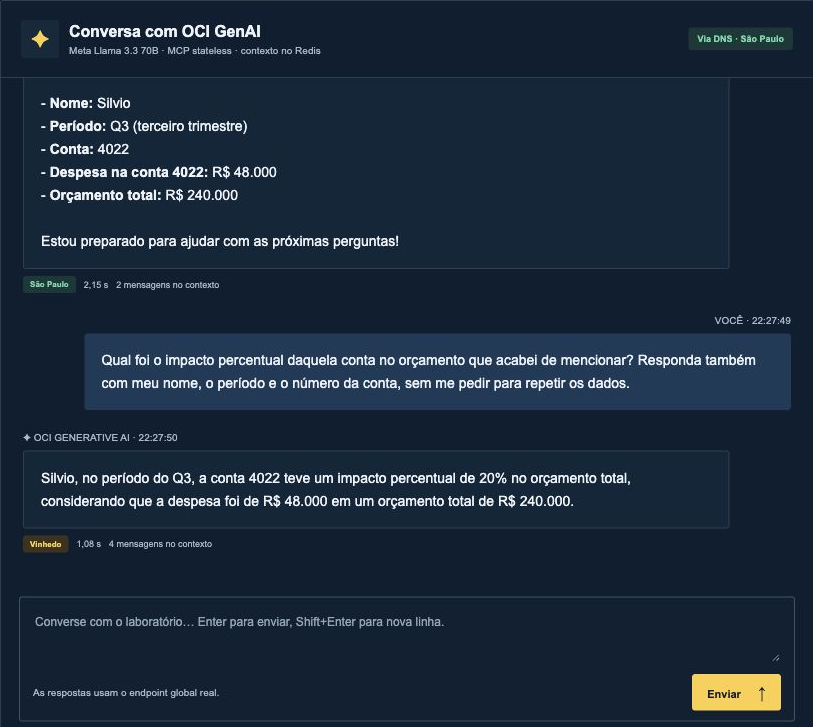
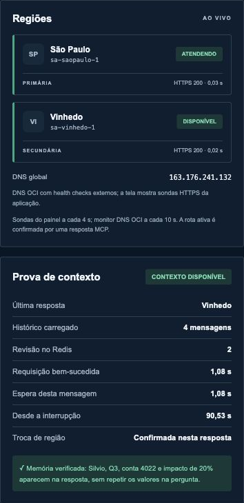
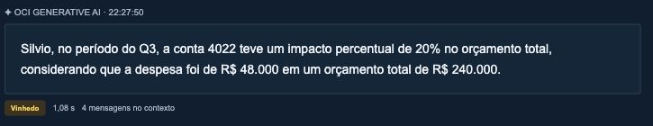
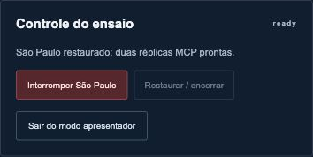

# Manual do usuário do chat MCP

Este manual orienta participantes e apresentadores a usar o laboratório de conversação com OCI Generative AI. Você aprenderá a iniciar uma conversa, acompanhar a região que respondeu e conferir se os dados anteriores foram preservados após a interrupção do MCP primário.

O laboratório possui uma aplicação MCP em São Paulo e outra em Vinhedo. O apresentador controla a interrupção. Os participantes continuam fazendo perguntas em suas próprias conversas. A demonstração interrompe a aplicação MCP de São Paulo; o Redis gravável e a execução do modelo continuam nessa região.

Autor do laboratório: Silvio Cristiano. Edição de referência: 9 de novembro de 2026. As figuras são capturas reais da aplicação e usam dados financeiros fictícios. Cores, tempos e indicadores podem mudar durante sua sessão.

## 1 Acessar o chat

Abra **https://racing-brazil-ai.tech/chat/** no navegador do computador ou celular. Não é necessário instalar um cliente MCP. Em uma implantação do cliente, utilize o domínio informado pelo responsável técnico.

Na entrada normal aparece o rótulo **PARTICIPANTE**. Essa visão permite conversar, iniciar uma nova conversa e acompanhar a telemetria. Ela não apresenta botões de interrupção ou restauração.


**Figura 1.** A parte superior identifica o laboratório. Os atalhos para iniciar o contexto, testar a memória e abrir uma nova conversa ficam abaixo da capa.

Cada navegador recebe uma sessão individual. Duas abas do mesmo navegador normalmente compartilham essa sessão e o acesso do apresentador. Para simular duas pessoas no mesmo computador, use perfis de navegador separados ou uma janela anônima independente.

## 2 Conhecer os componentes da tela

| Componente | Para que serve |
| --- | --- |
| Nova conversa | Inicia outra sessão. Use quando quiser começar um assunto sem o contexto anterior. |
| Iniciar o contexto | Preenche a caixa de mensagem com o exemplo financeiro. Você ainda precisa clicar em Enviar. |
| Testar a memória | Preenche a pergunta de continuação. Também exige clicar em Enviar. |
| Conversa com OCI GenAI | Mostra suas mensagens, as respostas e a região que produziu cada resposta. |
| Via DNS | Mostra a rota global observada pela ferramenta de saúde. Pode ser diferente da região da última resposta, após uma recuperação. |
| Regiões | Mostra se São Paulo e Vinhedo estão respondendo às sondas HTTPS. |
| Prova de contexto | Mostra dados da última resposta da sua conversa. |
| Linha do tempo | Registra eventos de infraestrutura compartilhados, como a interrupção conduzida pelo apresentador e a recuperação. |

A linha do tempo é comum ao laboratório. Os balões de conversa pertencem à sua sessão; as perguntas de outros participantes não aparecem neles.

## 3 Enviar a primeira mensagem

1. Clique em **Iniciar o contexto** ou digite sua própria pergunta.
2. Revise o texto na caixa de mensagem.
3. Clique em **Enviar**. Você também pode pressionar **Enter**.
4. Para inserir uma quebra de linha sem enviar, use **Shift + Enter**.
5. Aguarde a resposta. Durante o processamento, os controles de envio ficam temporariamente indisponíveis.

Use somente informações fictícias. O ambiente de demonstração não foi preparado para receber dados reais de clientes, senhas ou documentos confidenciais.



**Figura 2.** A pergunta aparece em um balão azul. A resposta informa a região, o tempo da requisição e a quantidade de mensagens no contexto.

### Texto inicial para copiar

```text
Olá! Sou o Silvio. Estou analisando o relatório financeiro do Q3.
A conta 4022 teve uma despesa de R$ 48.000, em um orçamento total
de R$ 240.000. Guarde esses detalhes para as próximas perguntas
e confirme o nome, o período e a conta.
```

Após a primeira resposta, confira se o assistente reconheceu Silvio, Q3, conta 4022, despesa de R$ 48.000 e orçamento de R$ 240.000. O painel normalmente registra **2 mensagens** e **revisão 1**: uma mensagem sua e uma do assistente.

## 4 Interpretar as regiões e os tempos

**ATENDENDO** significa que o painel observou uma resposta da ferramenta MCP de saúde pelo endereço global naquela região. **DISPONÍVEL** significa que a sonda regional respondeu, mas essa região não foi identificada como a rota global ativa. **INDISPONÍVEL** significa que a sonda falhou ou excedeu o tempo de espera.



**Figura 3.** A última resposta veio de Vinhedo, mas a rota global já voltou a São Paulo. Isso é esperado depois da restauração: cada campo descreve um momento diferente.

| Campo | Como interpretar |
| --- | --- |
| Última resposta | Região que respondeu à última pergunta desta conversa. |
| Histórico carregado | Quantidade de mensagens incluídas no estado confirmado da conversa. |
| Revisão no Redis | Número de turnos concluídos e gravados. Não é a quantidade de réplicas do Cache. |
| Requisição bem-sucedida | Duração da chamada MCP que obteve a resposta. Não representa toda a recuperação por DNS. |
| Espera desta mensagem | Tempo total de processamento e eventuais repetições seguras desta pergunta. |
| Desde a interrupção | Intervalo entre a interrupção registrada e a chegada desta resposta em Vinhedo. Pode incluir o tempo que você esperou antes de perguntar. |
| Troca de região | Confirma se a resposta atual veio de uma região diferente da resposta anterior desta sessão. |

O indicador **CONTEXTO DISPONÍVEL** considera a quantidade de mensagens. A comprovação funcional exige que a resposta recupere os detalhes anteriores. No exemplo predefinido, a faixa **Memória verificada** reconhece nome, período, conta e resultado de 20%. Em assuntos livres essa faixa pode não aparecer, mesmo com contexto preservado.

## 5 Fazer o teste de continuidade como participante

Antes da interrupção, envie o texto inicial e aguarde sua primeira resposta. O apresentador deve avisar o grupo antes de interromper o MCP primário.

1. Mantenha a mesma página e a mesma conversa abertas.
2. Observe a indicação de indisponibilidade de São Paulo.
3. Clique em **Testar a memória** e depois em **Enviar**, ou copie o texto abaixo.
4. Aguarde a reconexão. Não clique em Nova conversa durante esse teste.
5. Confira a região no rodapé do balão da resposta e os detalhes recuperados.

### Pergunta de continuação para copiar

```text
Qual foi o impacto percentual daquela conta no orçamento que
acabei de mencionar? Responda também com meu nome, o período
e o número da conta, sem me pedir para repetir os dados.
```

A resposta esperada deve recuperar **Silvio**, **Q3** e **conta 4022**, além de calcular **20%**, pois 48.000 dividido por 240.000 corresponde a 0,20. Esses valores não foram repetidos na pergunta de continuação.



**Figura 4.** Captura real de uma resposta de Vinhedo, com quatro mensagens no contexto. O texto pode variar; valide os fatos recuperados, não uma frase idêntica.

O failover depende das sondas, da política DNS e dos caches de resolução. Podem ocorrer respostas 503 e um período de reconexão. Uma resposta de um segundo depois da troca não significa que toda a recuperação levou um segundo. O laboratório não demonstrou zero downtime.

## 6 Entrar como apresentador

Abra **https://racing-brazil-ai.tech/chat/presenter**. Digite a senha fornecida pelo responsável técnico e clique em **Entrar**. Não divulgue essa senha ao público. Ela não está no GitHub nem neste manual.


**Figura 5.** A autenticação libera a visão do apresentador. O acesso dos participantes ao chat continua sem essa senha.

Após entrar, confirme o rótulo **APRESENTADOR**. A sessão de apresentação tem validade de quatro horas. Se o acesso expirar, entre novamente. Use **Sair do modo apresentador** ao terminar, principalmente em um computador compartilhado.

## 7 Interromper e restaurar a aplicação



**Figura 6.** O botão vermelho e o botão de restauração ficam no painel Controle do ensaio. O botão do ato 02 executa a mesma interrupção.

### Antes de interromper

1. Confirme São Paulo **ATENDENDO** e Vinhedo **DISPONÍVEL**.
2. Peça que os participantes enviem a primeira mensagem e aguardem a resposta.
3. Avise que haverá um período de reconexão.
4. Confira se o controle está em **ready** e se o botão de interrupção está habilitado.

### Durante a interrupção

Clique **uma vez** em **Interromper São Paulo** ou no ato **02 Interromper o MCP primário**. O sistema reduz de duas para zero as réplicas do Deployment MCP primário. Ele mantém a interface web, os workers OKE, o Redis e o GenAI.

O estado passa por **injecting** e depois **fault**. Os participantes não ganham acesso aos controles; eles apenas observam as mudanças e continuam perguntando. O cronômetro indica a restauração automática, prevista para cinco minutos após a interrupção.

### Restaurar

Clique em **Restaurar / encerrar** para antecipar a recuperação. Aguarde **restoring** e, depois, **ready**. A aplicação confirma duas réplicas MCP prontas em São Paulo; o DNS retorna ao primário conforme suas verificações e caches.

O botão de restauração desabilitado quando tudo está pronto é normal. A recuperação automática roda no OKE e não depende de manter seu Mac ou navegador ligados. Se o Cache, a API Kubernetes ou o controlador estiverem indisponíveis, o responsável técnico deve executar a recuperação descrita no manual técnico.

## 8 Reiniciar uma conversa e respeitar os limites

**Nova conversa** cria outro identificador. Use esse botão quando quiser começar sem a memória da conversa anterior. Ele não é um comando de exclusão imediata dos dados técnicos já gravados no Redis.

O histórico da interface expira 24 horas após a última gravação correspondente. O backend MCP mantém a política original de contexto sem TTL. Limpar cookies, mudar de navegador ou entrar por outro domínio pode iniciar outra sessão.

A configuração do laboratório aceita até **8.000 caracteres por mensagem**, **6 mensagens por minuto por conversa**, **60 por minuto no total**, **600 por hora**, **2.000 por dia** e até **12 trabalhos simultâneos**. Uma conversa processa uma mensagem de cada vez. Em caso de limite, aguarde antes de reenviar.

## 9 Resolver situações comuns

| Situação | O que fazer |
| --- | --- |
| Não vejo os controles de interrupção | Confira se você entrou no endereço do apresentador e se o rótulo APRESENTADOR aparece. Participantes não devem ver esses controles. |
| São Paulo está indisponível e a mensagem aguarda | Mantenha a conversa aberta. Aguarde a convergência do DNS e acompanhe o banner e a linha do tempo. |
| A resposta não foi confirmada | Confira o histórico antes de reenviar. Erros de transporte ou execução incerta não são repetidos automaticamente. |
| Recebi aviso de limite | Aguarde a janela de participação indicada pelo responsável; não abra várias sessões para contornar o limite. |
| Duas pessoas no mesmo computador veem a mesma conversa | Use perfis de navegador separados. Abas de um mesmo perfil compartilham cookies. |
| A última resposta indica Vinhedo e a rota atual indica São Paulo | É uma recuperação normal. O balão guarda a origem daquela resposta; a rota atual é uma nova observação. |
| A resposta esqueceu os valores | Confirme que não iniciou Nova conversa nem trocou de perfil. Confira a primeira mensagem e o histórico. Registre o horário e encaminhe ao responsável técnico. |
| O apresentador recebeu erro no controle | Verifique a linha do tempo antes de repetir. Use Restaurar quando habilitado e chame o responsável se São Paulo não voltar. |

## 10 Conferir o resultado da demonstração

Considere o teste funcional concluído quando a mesma sessão recebeu uma primeira resposta de São Paulo, uma resposta posterior de Vinhedo, os fatos anteriores foram recuperados corretamente e São Paulo foi restaurado. Os tempos são medições daquela execução e variam conforme a rede e o serviço.

Para reproduzir a infraestrutura em sua tenancy, utilize o [manual técnico](manual-tecnico.md). Para baixar uma versão para compartilhar, abra a pasta [downloads](downloads/).
